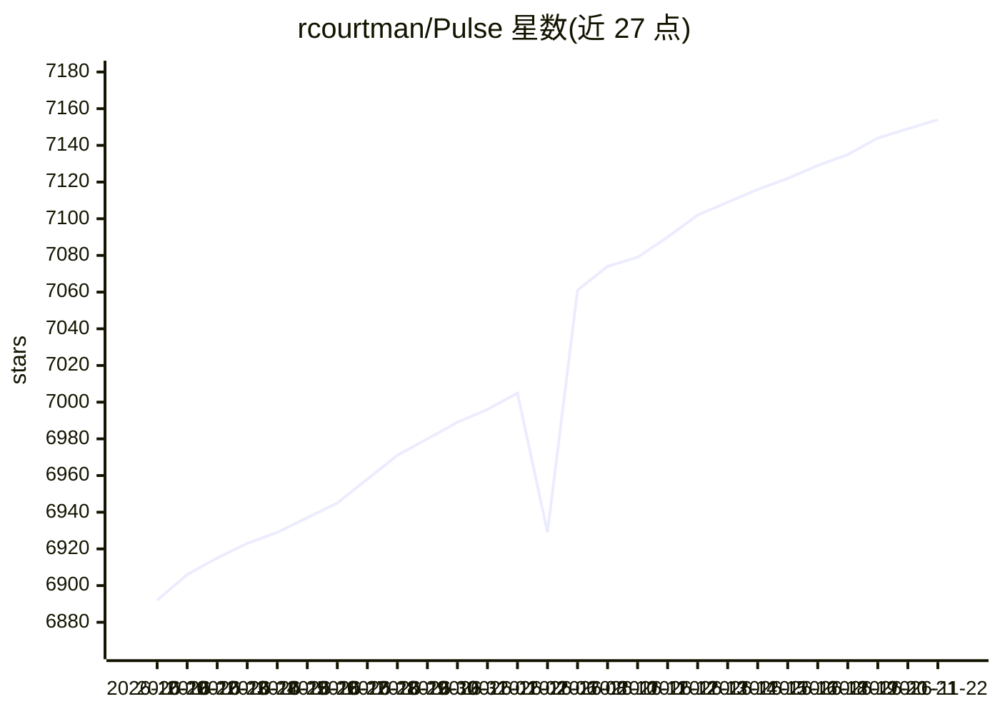

# rcourtman/Pulse

⭐ 7,154 · Go · MIT · 推送 2026-11-21 · [GitHub](https://github.com/rcourtman/Pulse) · [官网](https://pulserelay.pro) · 个人维护

**面向 homelab 与基础设施的自托管实时监控告警面板**

自托管的监控仪表盘与告警工具：接入 Proxmox VE/PBS、Docker/Podman、Kubernetes、TrueNAS、vSphere 及 Linux/Windows/macOS 主机，按平台分页展示状态，保留 90 天历史图表；对 CPU、内存、磁盘、温度设阈值告警，支持邮件及 Discord/Slack/Telegram/ntfy 等 webhook 通知，并提供 Ping/TCP/UDP/HTTP 探测与证书到期提醒。可选的 Patrol 功能接入用户自己的 AI 提供商或本地模型执行定时检查；通过 pulse-mcp 可让 Claude Code 等 agent 查询数据。Docker 或签名安装脚本部署，监听 7655 端口。

## 筛选速览

| 维度 | 判定 | 备注 |
|---|---|---|
| AI 角色 | `ai-enhanced` | 去掉 AI 部分产品仍成立 |
| 许可风险 | `permissive` | MIT |
| 部署形态 | `self-host` | docker 或自建部署 |
| 模型依赖 | — | README 未给出锁定关系 |
| 硬件要求 | — | 无带数字的原话,不猜 |
| 安装摩擦 | `low` | 无编译、无系统依赖或容器化 |
| 成熟度 | `idea` | |

## 能力要点

- 支持 Proxmox、Docker、Kubernetes、TrueNAS、vSphere 等平台的分页视图
- 阈值告警支持邮件与 Discord/Slack/Teams/Telegram/ntfy 等多种通知渠道
- 可选 Patrol 功能接入自有 AI 提供商或本地模型做定时检查
- 提供 pulse-mcp，供 Claude Code/Codex/OpenCode 等 agent 只读查询

## 适用场景

- 集中监控 homelab 的虚拟机、容器与存储状态
- 备份失败、磁盘将满、节点离线时收到告警
- 让 AI agent 查询隔夜基础设施发生了什么变化

## 场景标签

 · 领域:基础设施监控/运维

## 证据(README 行号)

> L13: Pulse is a self-hosted dashboard and alerting tool for your homelab or
> L40: - **Optional AI checks.** Connect your own AI provider or a local model and
> L43: - **Answers your own AI agent.** Point Claude Code, Codex or OpenCode at Pulse

## 星数曲线

2026-10-20 6,892 → 2026-11-22 7,154（+262）

---
*卡片 v1 · prompt 1.4 · 生成 2026-11-22 · 置信度 high · 依据 README sha `a8789716bf59` · [字段定义](../../DATASET.md)*
