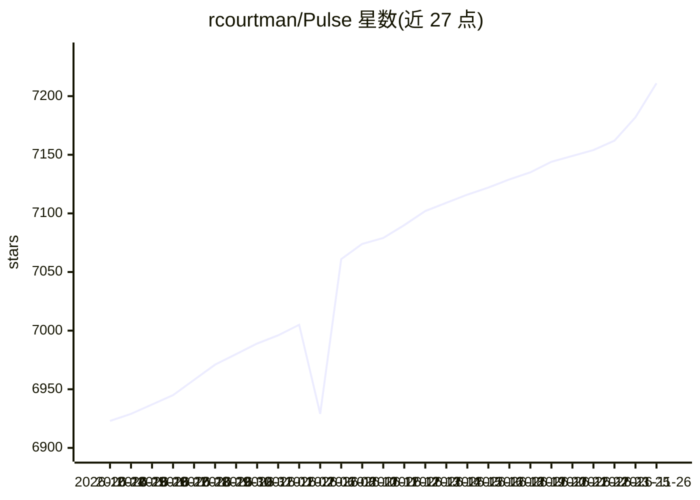

# rcourtman/Pulse

⭐ 7,211 · Go · MIT · 推送 2026-11-25 · [GitHub](https://github.com/rcourtman/Pulse) · [官网](https://pulserelay.pro) · 个人维护

**自托管监控面板：为 Proxmox 等基础设施提供实时监控与告警**

面向 Proxmox VE/PBS、Docker、Kubernetes、TrueNAS、vSphere 与 Linux/Windows/macOS 主机的自托管监控告警面板：单服务器采集健康状态、备份覆盖、可用性检查与指标历史，通过邮件/Discord/Slack/Telegram/webhook 等通道告警。多数场景经只读 API 连接无需安装 agent，另提供统一 agent 覆盖容器与传感器数据。AI 为可选项：Pulse Patrol 用用户自备的 AI provider 或本地模型做定时检查，pulse-mcp 供编码代理查询变更。社区版 MIT 许可，另有商业 Pro/MSP 版。

## 筛选速览

| 维度 | 判定 | 备注 |
|---|---|---|
| AI 角色 | `ai-enhanced` | 去掉 AI 部分产品仍成立 |
| 许可风险 | `permissive` | MIT |
| 部署形态 | `self-host` | docker 或自建部署 |
| 模型依赖 | — | README 未给出锁定关系 |
| 硬件要求 | — | 无带数字的原话,不猜 |
| 安装摩擦 | `low` | 无编译、无系统依赖或容器化 |
| 成熟度 | `idea` | |

## 能力要点

- 覆盖 Proxmox/PBS/Docker/Kubernetes/TrueNAS/vSphere 的实时监控与告警
- 内置指标历史（CPU/内存/磁盘/网络），无需外部数据库
- Ping/TCP/UDP/HTTP(S)/TLS 过期可用性检查与多通道告警
- 可选 AI：Pulse Patrol 定时检查与 pulse-mcp 接入编码代理

## 适用场景

- 监控家庭实验室或生产环境的 Proxmox 虚拟化集群
- 及时发现失败备份、磁盘写满、容器异常与离线节点
- 用自备 AI 模型对基础设施变更做定时巡检

## 场景标签

 · 领域:IT 基础设施监控

## 证据(README 行号)

> L13: Pulse is a self-hosted monitoring and alerting dashboard for Proxmox, Docker,
> L64: ### Optional AI & MCP

## 星数曲线

2026-10-24 6,923 → 2026-11-26 7,211（+288）

---
*卡片 v1 · prompt 1.4 · 生成 2026-11-24 · 置信度 high · 依据 README sha `c06730d73fc6` · [字段定义](../../DATASET.md)*
