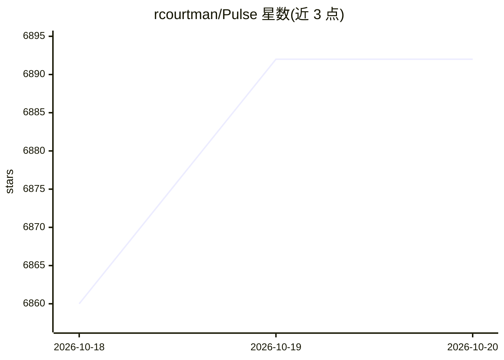

# rcourtman/Pulse

⭐ 6,892 · Go · MIT · 推送 2026-10-19 · [GitHub](https://github.com/rcourtman/Pulse) · [官网](https://pulserelay.pro) · 个人维护

**自托管基础设施监控面板：覆盖 Proxmox/Docker/K8s/TrueNAS 等**

面向运维者的自托管监控工作台，通过 Proxmox API 与统一 agent 采集 Proxmox VE/PBS/PMG、Docker/Podman、Kubernetes、TrueNAS、Linux/Windows/macOS 机器及早期访问 vSphere 的实时状态、历史、告警与备份可见性。AI 部分为 Pulse Patrol 定时巡检（社区版可用本地模型或自有 provider 做 watch-only 分析），另有交互式 Assistant 与供 Claude Code、OpenCode 等外部客户端使用的 MCP 适配器。提供 Docker、签名安装脚本、Compose 与 Helm 部署方式；分 Community/Pro/MSP 版本，Pro 增加调查、治理化修复与 RBAC。

## 筛选速览

| 维度 | 判定 | 备注 |
|---|---|---|
| AI 角色 | `ai-enhanced` | 去掉 AI 部分产品仍成立 |
| 许可风险 | `permissive` | MIT |
| 部署形态 | `self-host` | docker 或自建部署 |
| 模型依赖 | — | README 未给出锁定关系 |
| 硬件要求 | — | 无带数字的原话,不猜 |
| 安装摩擦 | `low` | 无编译、无系统依赖或容器化 |
| 成熟度 | `idea` | |

## 能力要点

- 跨平台统一资源模型：搜索、告警、历史与巡检共用一套数据
- Pulse Patrol 定时巡检，社区版可接本地模型或自有 AI provider
- MCP 适配器供 Claude Code、OpenCode 等外部客户端接入
- agent 默认禁用命令执行、凭证静态加密、API token 限定作用域

## 适用场景

- 统一监控家里的 Proxmox、Docker 与 Kubernetes 环境
- 在无人值守时发现失败备份、重启循环、容量压力等静默故障
- MSP 为多个客户运行隔离的监控工作台

## 场景标签

 · 领域:基础设施监控/运维

## 证据(README 行号)

> L13: Pulse is a self-hosted monitoring workspace for Proxmox, Docker, Kubernetes,
> L49: Pulse Patrol runs scheduled checks across the current state and recent history
> L56: Pulse also includes an interactive Assistant and an MCP adapter for external

## 星数曲线

2026-10-18 6,860 → 2026-10-20 6,892（+32）

---
*卡片 v1 · prompt 1.4 · 生成 2026-10-20 · 置信度 high · 依据 README sha `ce6a97b4c407` · [字段定义](../../DATASET.md)*
