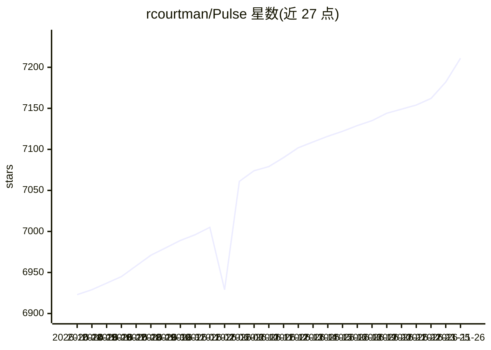

# rcourtman/Pulse

⭐ 7,211 · Go · MIT · 推送 2026-11-25 · [GitHub](https://github.com/rcourtman/Pulse) · [官网](https://pulserelay.pro) · 个人维护

**面向自托管基础设施的实时监控与告警面板**

Pulse 是一个自托管的监控与告警仪表盘，覆盖 Proxmox VE/PBS、Docker/Podman、Kubernetes、TrueNAS 及 Linux/Windows/macOS 主机，跟踪健康状态、备份覆盖、可用性检查与指标历史，并在磁盘满、容器异常、节点离线等情况下通过邮件/Discord/Slack/Telegram 等渠道告警。单 Go 二进制 + 内置 SQLite，无外部数据库；Proxmox 等通过只读 token 走 API 接入，通常无需安装 agent。AI 为可选项：Pulse Patrol 使用用户自备的 AI provider 或本地模型执行定时检查，pulse-mcp 供 Claude Code 等查询变更。仓库本体为 MIT，Pro/MSP 为单独商业产品。

## 筛选速览

| 维度 | 判定 | 备注 |
|---|---|---|
| AI 角色 | `ai-enhanced` | 去掉 AI 部分产品仍成立 |
| 许可风险 | `permissive` | MIT |
| 部署形态 | `self-host` | docker 或自建部署 |
| 模型依赖 | — | README 未给出锁定关系 |
| 硬件要求 | — | 无带数字的原话,不猜 |
| 安装摩擦 | `low` | 无编译、无系统依赖或容器化 |
| 成熟度 | — | 结构信号不足 |

## 能力要点

- 单一轻量 server 覆盖 Proxmox/Docker/Kubernetes/TrueNAS 等平台监控
- 内置指标历史与 SQLite，无需外部数据库，基线 1-2 vCPU/1 GiB RAM
- 阈值加 Ping/TCP/UDP/HTTP(S)/TLS 过期检查，多渠道告警
- 可选 AI：Pulse Patrol 定时检查与 pulse-mcp 查询接口

## 适用场景

- 自托管 Proxmox/Kubernetes 集群的健康与备份监控
- 及时发现失败的备份任务、满磁盘、离线节点并告警
- MSP 按客户端隔离管理多套基础设施

## 场景标签

 · 领域:基础设施监控/运维

## 证据(README 行号)

> L13: Pulse is a self-hosted monitoring and alerting dashboard for Proxmox, Docker,
> L63: ### Optional AI & MCP
> L64: Pulse Patrol runs scheduled checks with your own AI provider or local model. `pulse-mcp` lets Claude Code, Codex, o

## 星数曲线

2026-10-24 6,923 → 2026-11-26 7,211（+288）

---
*卡片 v1 · prompt 1.4 · 生成 2026-11-26 · 置信度 high · 依据 README sha `2d10f87026c7` · [字段定义](../../DATASET.md)*
