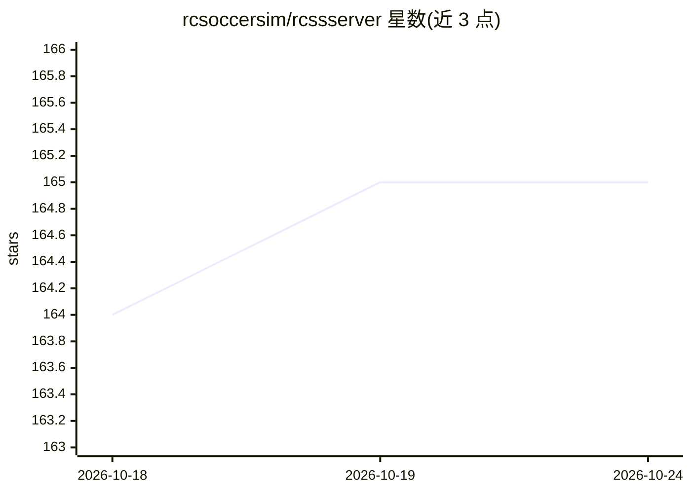

# rcsoccersim/rcssserver

⭐ 165 · C++ · LGPL-3.0 · 推送 2025-12-15 · [GitHub](https://github.com/rcsoccersim/rcssserver) · 组织维护

**多智能体与 AI 研究用的机器人足球仿真服务器**

RoboCup 足球仿真服务器：用 C++14 实现，模拟 11 名自主机器人球员进行足球比赛，管理仿真进程并与控制机器人的客户端程序通信，是面向多智能体系统与人工智能研究和教育的工具。源码以 configure/make 或 CMake（17.0.0 起支持）构建，运行需另行安装监视器（rcssmonitor）才能可视化赛场，提供 rcssclient 示例客户端与 rcsoccersim 启动脚本。

## 筛选速览

| 维度 | 判定 | 备注 |
|---|---|---|
| AI 角色 | `ai-ecosystem` | LLM/agent 周边工具 |
| 许可风险 | `viral` | LGPL-3.0 |
| 部署形态 | `None` |  |
| 模型依赖 | — | README 未给出锁定关系 |
| 硬件要求 | — | 无带数字的原话,不猜 |
| 安装摩擦 | `medium` | 含编译或系统依赖之一 |
| 成熟度 | — | 结构信号不足 |

## 能力要点

- 11 名仿真自主球员的足球比赛环境，供客户端程序控制
- 提供示例客户端 rcssclient 与 rcsoccersim 一键启动脚本
- configure 与 CMake 两种构建方式，configure 阶段可开关功能（如 rcssclient、debug）
- 支持比赛录制回放（需 rcssmonitor 日志播放器）

## 适用场景

- 多智能体系统与 AI 算法的研究和教学实验
- RoboCup 仿真组比赛环境搭建
- 开发和调试控制仿真机器人的客户端程序

## 场景标签

`多智能体` · 领域:Agent 开发

## 证据(README 行号)

> L8: The RoboCup Soccer Simulator Server (rcssserver) is a research and educational tool for multi-agent systems and arti
> L45: The simulator server manages the actual simulation and comunicates with client programs that

## 星数曲线

2026-10-18 164 → 2026-10-24 165（+1）

---
*卡片 v1 · prompt 1.4 · 生成 2026-10-22 · 置信度 high · 依据 README sha `412a4f82d6b3` · [字段定义](../../DATASET.md)*
