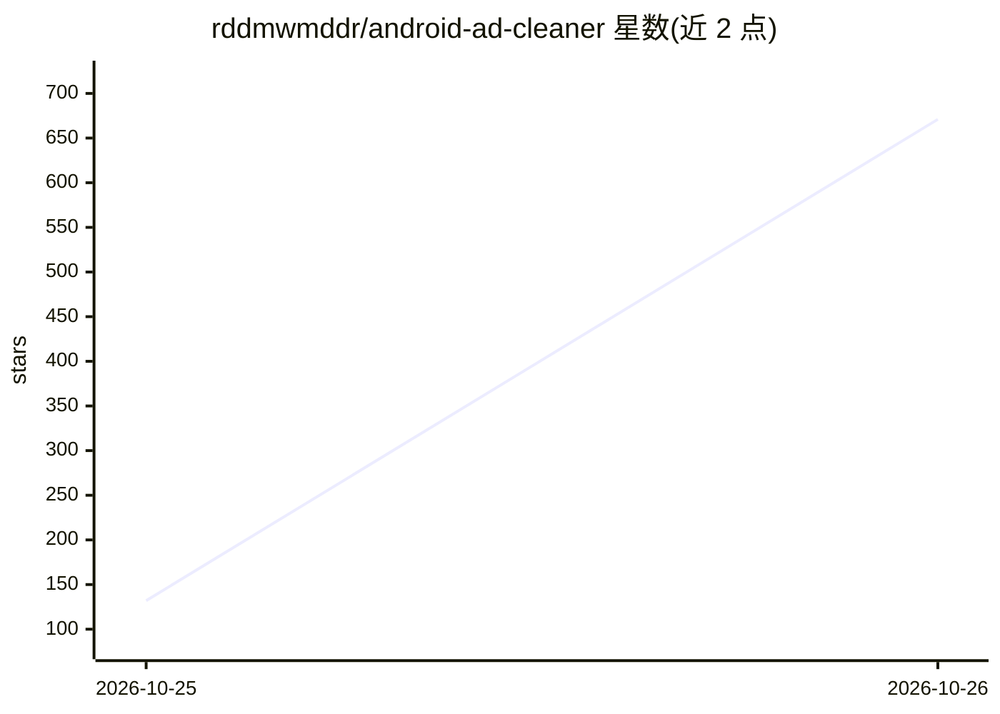

# rddmwmddr/android-ad-cleaner

⭐ 671 · Python · MIT · 推送 2026-10-25 · [GitHub](https://github.com/rddmwmddr/android-ad-cleaner) · 个人维护 · 中文 README

**不 root 关闭国产安卓手机系统广告与营销推送的工具，支持 AI 智能体执行**

面向国产安卓手机（荣耀/OPPO/小米/vivo）用户，通过 ADB 调用系统和厂商 App 公开设置项，关闭系统广告、热搜资讯、推广位、营销推送，并可挂起广告组件和关闭快应用；不 root、不解锁、每步可还原，保留天气预警、快递提醒等功能。提供三种用法：AI 智能体执行（读取 AGENTS.md 规范）、聊天 AI 引导手动操作、照清单手动关；另提供 Mac/Windows 桌面客户端。机型脚本按型号和系统版本存放，实测机型有限，未覆盖机型需自行编写脚本。

## 筛选速览

| 维度 | 判定 | 备注 |
|---|---|---|
| AI 角色 | `ai-enhanced` | 去掉 AI 部分产品仍成立 |
| 许可风险 | `permissive` | MIT |
| 部署形态 | `desktop` | 安装包/桌面程序 |
| 模型依赖 | — | README 未给出锁定关系 |
| 硬件要求 | — | 无带数字的原话,不猜 |
| 安装摩擦 | `low` | 无编译、无系统依赖或容器化 |
| 成熟度 | — | 结构信号不足 |

## 能力要点

- 不 root/不解锁，通过公开设置项与 pm suspend 处理，可一条命令还原
- 三种用法：AI 智能体替跑、聊天 AI 带点、手动清单，另有桌面客户端
- 机型脚本按型号和系统版本存放，版本不匹配时提示并跳过
- 营销通知按渠道关闭，保留订单、快递、天气预警等通知

## 适用场景

- 我想关掉手机里的系统广告和资讯推荐但不 root
- 让 AI 智能体连上电脑替我执行去广告步骤
- 只关营销推送、保留快递和天气预警等有用通知

## 场景标签

`GUI 自动化` · 领域:效率与自动化

## 证据(README 行号)

> L3: 关掉国产安卓手机系统里的广告、热搜、资讯推荐和营销推送。
> L59: |**一：AI 智能体替你跑**|有电脑，想省事|电脑、数据线、一个能执行命令的 AI 工具|docs/02-用AI智能体.md|
> L60: |**二：聊天 AI 带你点**|只有手机|DeepSeek、豆包、ChatGPT 任意一个|docs/03-用聊天AI.md|

## 星数曲线

2026-10-25 132 → 2026-10-26 671（+539）

---
*卡片 v1 · prompt 1.4 · 生成 2026-10-24 · 置信度 mid · 依据 README sha `fef608deaf2c` · [字段定义](../../DATASET.md)*
