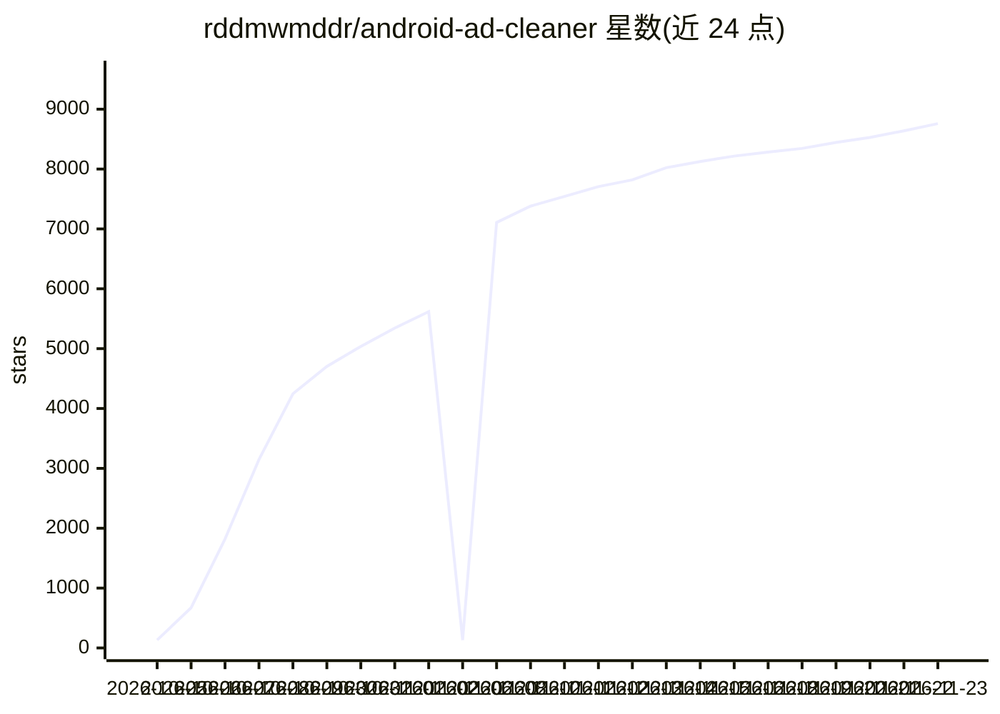

# rddmwmddr/android-ad-cleaner

⭐ 8,759 · Python · MIT · 推送 2026-11-21 · [GitHub](https://github.com/rddmwmddr/android-ad-cleaner) · 个人维护 · 中文 README

**国产安卓手机去广告工具，支持 AI 智能体一键执行**

面向国产安卓手机（ColorOS、HyperOS、OriginOS、MagicOS、Flyme 等）的工具，通过系统设置开关、通知渠道关闭和 pm suspend 挂起广告组件来关掉系统广告、热搜、资讯推荐和营销推送；不 root、不解锁、不改 system 分区，挂起操作可一条命令还原。提供五种用法：AI 智能体执行、聊天 AI 引导、手动清单、桌面客户端（Mac/Windows 安装包）与安卓手机版 App；按机型维护脚本并附真机验证记录。

## 筛选速览

| 维度 | 判定 | 备注 |
|---|---|---|
| AI 角色 | `ai-enhanced` | 去掉 AI 部分产品仍成立 |
| 许可风险 | `permissive` | MIT |
| 部署形态 | `desktop` | 安装包/桌面程序 |
| 模型依赖 | — | README 未给出锁定关系 |
| 硬件要求 | — | 无带数字的原话,不猜 |
| 安装摩擦 | `low` | 无编译、无系统依赖或容器化 |
| 成熟度 | — | 结构信号不足 |

## 能力要点

- 不 root、不解锁、不刷机，操作可还原
- 桌面客户端 Mac（Apple/Intel）与 Windows 安装版/免安装版，另有安卓手机版 App
- AI 智能体用法：克隆仓库读 AGENTS.md 后由 AI 执行
- 60+ 款机型真机实测记录与回读验证

## 适用场景

- 关闭小米/OPPO/vivo/荣耀等国产手机系统里的广告和营销推送
- 用 AI 智能体在电脑上自动执行去广告流程
- 不想连电脑时用手机版 App 直接处理

## 场景标签

`GUI 自动化` · 领域:效率与自动化

## 证据(README 行号)

> L3: 关掉国产安卓手机系统里的广告、热搜、资讯推荐和营销推送。
> L39: - 不 root，不解锁，不刷机，系统更新不受影响。
> L72: |**一：AI 智能体替你跑**|有电脑，想省事|电脑、数据线、一个能执行命令的 AI 工具|docs/02-用AI智能体.md|

## 星数曲线

2026-10-25 132 → 2026-11-23 8,759（+8,627）

---
*卡片 v1 · prompt 1.4 · 生成 2026-11-23 · 置信度 mid · 依据 README sha `2d3e2a082b0d` · [字段定义](../../DATASET.md)*
