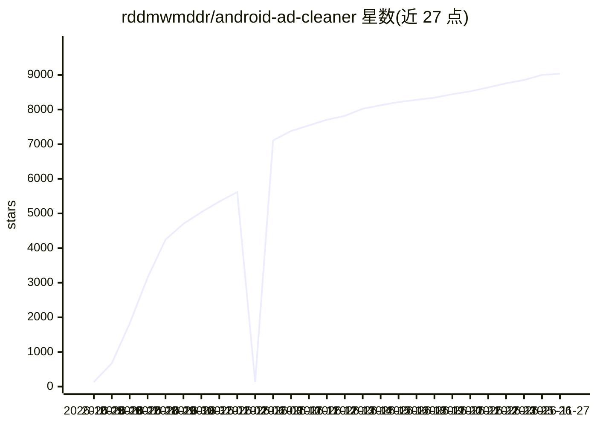

# rddmwmddr/android-ad-cleaner

⭐ 9,034 · Python · MIT · 推送 2026-11-24 · [GitHub](https://github.com/rddmwmddr/android-ad-cleaner) · 个人维护 · 中文 README

**关闭国产安卓手机系统广告与营销推送的可还原工具**

面向国产安卓手机（魅族/华为/荣耀/一加/OPPO/小米/vivo/realme/三星）的广告关闭工具，处理系统广告、热搜资讯、商店推广位、营销推送、广告组件与快应用六类目标。不 root、不解锁、不刷机，只拨系统和 App 自带开关，`pm suspend` 需机主同意，一条命令可还原。提供五种用法：AI 智能体执行、聊天 AI 指导、手动清单、桌面客户端（Mac/Windows）、手机版 App；按机型维护脚本并记录真机实测与验证记录。

## 筛选速览

| 维度 | 判定 | 备注 |
|---|---|---|
| AI 角色 | `ai-enhanced` | 去掉 AI 部分产品仍成立 |
| 许可风险 | `permissive` | MIT |
| 部署形态 | `desktop` | 安装包/桌面程序 |
| 模型依赖 | — | README 未给出锁定关系 |
| 硬件要求 | — | 无带数字的原话,不猜 |
| 安装摩擦 | `low` | 无编译、无系统依赖或容器化 |
| 成熟度 | — | 结构信号不足 |

## 能力要点

- 五档用法：AI 智能体执行、聊天 AI 指导、手动清单、桌面客户端、手机版 App
- 不 root 不刷机，只拨系统自带开关，可一条命令还原
- 50 余款机型脚本，附真机实测日期与验证记录
- 保留搜索、天气预警、快递提醒等功能，按渠道关营销通知

## 适用场景

- 关闭小米/OPPO/vivo 等手机里的系统广告和信息流推荐
- 按渠道关营销推送同时保留订单和快递通知
- 不想 root 也不刷机的前提下净化手机系统
- 让 AI 智能体连电脑代为执行去广告步骤

## 场景标签

 · 领域:移动工具/系统优化

## 证据(README 行号)

> L3: 关掉国产安卓手机系统里的广告、热搜、资讯推荐和营销推送。
> L39: - 不 root，不解锁，不刷机，系统更新不受影响。
> L72: |**一：AI 智能体替你跑**|有电脑，想省事|电脑、数据线、一个能执行命令的 AI 工具|docs/02-用AI智能体.md|
> L76: |**五：手机版 App**|不想连电脑|安卓 11 及以上、Wi-Fi；安装包在下载表里|教程|

## 星数曲线

2026-10-25 132 → 2026-11-27 9,034（+8,902）

---
*卡片 v1 · prompt 1.4 · 生成 2026-11-24 · 置信度 mid · 依据 README sha `7a14a8cb0cc5` · [字段定义](../../DATASET.md)*
