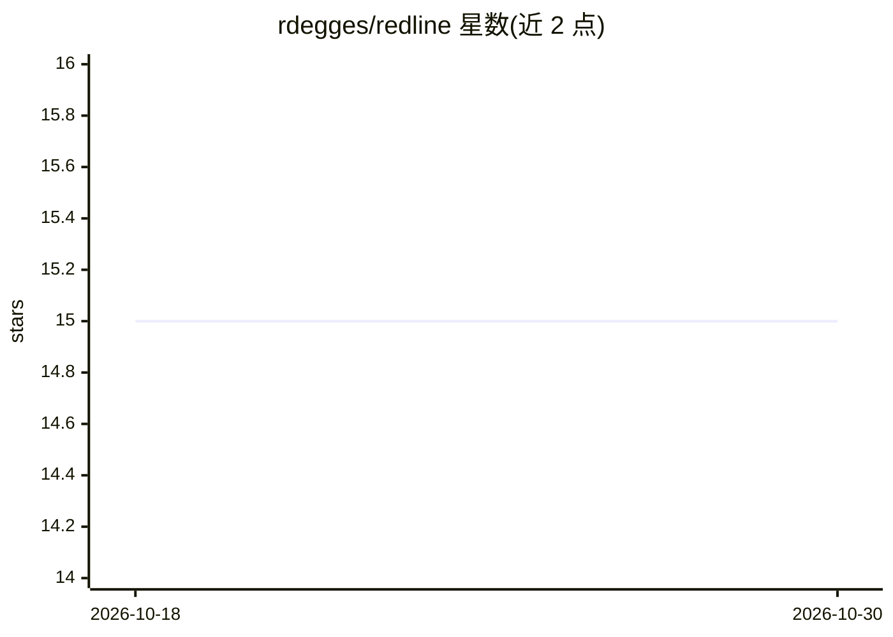

# rdegges/redline

⭐ 15 · Go · MIT · 推送 2026-08-31 · [GitHub](https://github.com/rdegges/redline) · 个人维护

**本地 LLM 驱动的网站品牌信息一致性审计 CLI**

Go 编写的单二进制命令行工具：爬取站点页面，用本地 Ollama 模型（默认 qwen3:30b 判分 + nomic-embed-text 嵌入）逐页比对用户提供的品牌核心信息与 GEO 目标提示词，输出包含逐字引用、位置提示与 preserve/remove/rewrite/add 编辑计划的 report.json/report.md，供下游编辑 agent 执行。五阶段流水线（爬取→抽取→判分→嵌入去重→报告）以 SQLite 存状态，支持断点续跑。默认本地运行无需云端 key，Anthropic/OpenAI 为可选。自述 Alpha 阶段，v1.0 前可能有破坏性变更，不支持 JavaScript 渲染。

## 筛选速览

| 维度 | 判定 | 备注 |
|---|---|---|
| AI 角色 | `ai-native` | 本体是模型或模型工具 |
| 许可风险 | `permissive` | MIT |
| 部署形态 | `desktop` | 安装包/桌面程序 |
| 模型依赖 | local-ok | 支持本地模型 |
| 硬件要求 | — | 无带数字的原话,不猜 |
| 安装摩擦 | `low` | 无编译、无系统依赖或容器化 |
| 成熟度 | `idea` | |

## 能力要点

- 爬取→LLM 判分→嵌入去重→报告的五阶段流水线，SQLite 状态支持断点续跑
- 每条发现绑定逐字引用与结构化编辑计划，供下游 agent 执行
- 默认 Ollama 本地运行，无需云端 API key；Anthropic/OpenAI 可选
- 报告含 JSON Schema 校验的 report.json 与 agent 可读的 report.md

## 适用场景

- 审计官网页面与品牌核心信息/GEO 目标提示词的偏离
- 把逐页修改计划交给下游编辑 agent 自动执行
- 本地零云端调用地跑全站内容一致性扫描

## 场景标签

 · 领域:SEO/GEO 内容审计工具

## 证据(README 行号)

> L12: `redline` is a single-binary command-line tool that audits a website's content against your canonical brand messagi
> L20: - **Local-first.** Default invocation uses Ollama on your machine. No cloud API keys required. No page content leav

## 星数曲线

2026-10-18 15 → 2026-10-30 15（+0）

---
*卡片 v1 · prompt 1.4 · 生成 2026-10-30 · 置信度 high · 依据 README sha `855773eb611a` · [字段定义](../../DATASET.md)*
