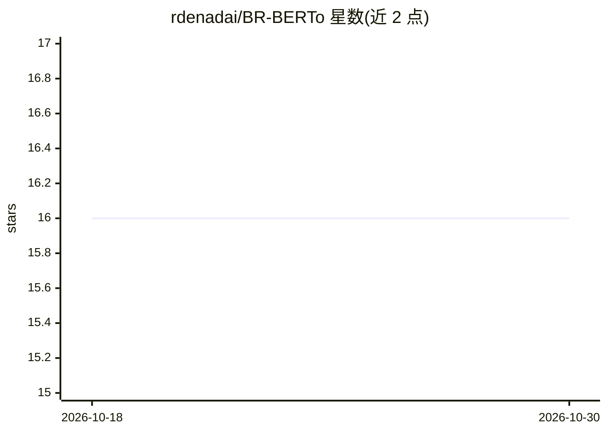

# rdenadai/BR-BERTo

⭐ 16 · Python · MIT · 推送 2026-09-01 · [GitHub](https://github.com/rdenadai/BR-BERTo) · [官网](https://huggingface.co/rdenadai/BR_BERTo) · 个人维护

**巴西葡萄牙语 RoBERTa 预训练语言模型**

面向巴西葡萄牙语（pt_BR）的 Transformer 预训练语言模型项目，基于 RoBERTa 架构（RobertaForMaskedLM）。最新模型在约 700 万句语料上训练，词表规模 150,000，训练 3 个 epoch，使用 GCP Nvidia T4 耗时约 10 天。首个版本模型托管在 GitHub releases，完整最新模型从 Hugging Face 页面下载。README 未提供安装命令或推理示例代码，训练流程参考 HuggingFace 团队教程。

## 筛选速览

| 维度 | 判定 | 备注 |
|---|---|---|
| AI 角色 | `ai-native` | 本体是模型或模型工具 |
| 许可风险 | `permissive` | MIT |
| 部署形态 | `None` |  |
| 模型依赖 | — | README 未给出锁定关系 |
| 硬件要求 | — | 无带数字的原话,不猜 |
| 安装摩擦 | `low` | 无编译、无系统依赖或容器化 |
| 成熟度 | — | 结构信号不足 |

## 能力要点

- 巴西葡萄牙语 RoBERTa 预训练模型
- 训练语料约 6,993,330 句，词表 150,000
- 完整模型托管于 Hugging Face（rdenadai/BR_BERTo）
- 首个版本可从 GitHub releases 获取

## 适用场景

- 为巴西葡萄牙语 NLP 任务提供预训练模型
- 下载模型用于下游任务的微调
- 参考其训练配置从零训练新语言模型

## 场景标签

`模型训练` · 领域:训练与推理

## 证据(README 行号)

> L2: Transformer model for Portuguese language (Brazil pt_BR)
> L6: The full and latest model, should be downloaded from **Huggingface** page: https://huggingface.co/rdenadai/BR_BERTo

## 星数曲线

2026-10-18 16 → 2026-10-30 16（+0）

---
*卡片 v1 · prompt 1.4 · 生成 2026-10-30 · 置信度 high · 依据 README sha `66c6eccbbbe7` · [字段定义](../../DATASET.md)*
