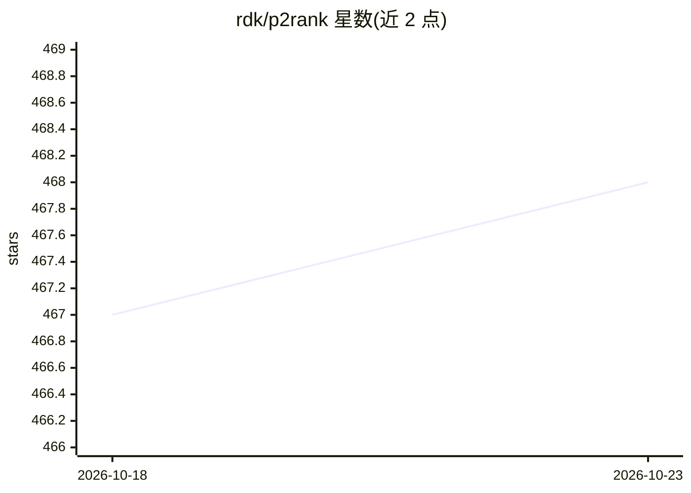

# rdk/p2rank

⭐ 468 · Groovy · MIT · 推送 2026-09-11 · [GitHub](https://github.com/rdk/p2rank) · 组织维护

**从蛋白质结构预测配体结合位点的命令行机器学习工具**

P2Rank 是独立命令行程序，基于机器学习模型对蛋白质溶剂可及表面点进行打分与聚类，预测配体结合口袋并输出带校准概率的口袋/残基 CSV 结果及 PyMOL/ChimeraX 可视化脚本。读取 PDB/mmCIF/BinaryCIF 输入，支持 AlphaFold/NMR/cryo-EM 结构专用配置，并可对 Fpocket、DeepSite 等十余种方法的预测结果重打分。运行需 Java 17+，二进制包从 GitHub Releases 下载，无需安装；面向计算结构生物学与药物发现研究者。

## 筛选速览

| 维度 | 判定 | 备注 |
|---|---|---|
| AI 角色 | `ai-native` | 本体是模型或模型工具 |
| 许可风险 | `permissive` | MIT |
| 部署形态 | `None` |  |
| 模型依赖 | — | README 未给出锁定关系 |
| 硬件要求 | — | 无带数字的原话,不猜 |
| 安装摩擦 | `medium` | 含编译或系统依赖之一 |
| 成熟度 | — | 结构信号不足 |

## 能力要点

- 对蛋白质表面 SAS 点打分聚类的结合位点预测，输出校准概率
- 支持 PDB/mmCIF/BinaryCIF 输入与 AlphaFold/NMR/cryo-EM 专用配置
- 可重打分 Fpocket、DeepSite 等 10 种方法的预测，含 fpocket-rescore 一键命令
- 可选导出口袋几何/静电描述符与 3D 网格（CSV/Arrow/Parquet）

## 适用场景

- 给定蛋白结构，预测可能的配体结合口袋用于药物发现
- 对 AlphaFold 或冷冻电镜模型做结合位点预测
- 对我用其他方法得到的口袋预测结果重新打分排序

## 场景标签

`科研工具` · 领域:学习与行业

## 证据(README 行号)

> L14: P2Rank is a stand-alone command-line program for fast and accurate prediction of ligand-binding sites from protein 
> L55: Ligandability score of individual points is determined by a machine learning model trained on a dataset of known pr

## 星数曲线

2026-10-18 467 → 2026-10-23 468（+1）

---
*卡片 v1 · prompt 1.4 · 生成 2026-10-21 · 置信度 high · 依据 README sha `4ae1f5daaeb4` · [字段定义](../../DATASET.md)*
