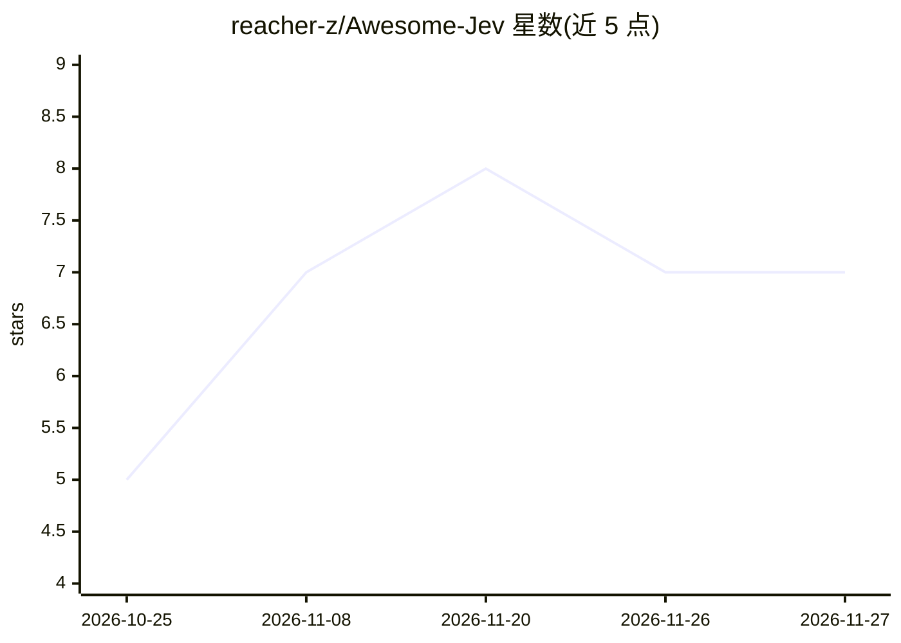

# reacher-z/Awesome-Jev

⭐ 7 · HTML · MIT · 推送 2026-11-03 · [GitHub](https://github.com/reacher-z/Awesome-Jev) · [官网](https://awesomejev.github.io/) · 组织维护 · 中文 README

**Jev 与 System One 决策模型的论文/模型/数据集策展清单**

独立社区维护的精选清单，收录 Jev 与类型化决策模型相关的论文（118 篇 arXiv 预印本）、模型、数据集、评测工具与实践指南，按评测、校准、鲁棒性、架构等主题组织，每条来源带版本号与验证级别标注，并区分摘要核查与全文评审。提供官网、调研综述、BibTeX 与贡献入口，中英双语。清单本身不提供模型或代码，仅聚合与核查外部资源，声明与 TypeSafe AI 无隶属关系。

## 筛选速览

| 维度 | 判定 | 备注 |
|---|---|---|
| AI 角色 | `ai-knowledge` | 知识聚合/清单类 |
| 许可风险 | `permissive` | MIT |
| 部署形态 | `library` | 以包/库形式分发 |
| 模型依赖 | — | README 未给出锁定关系 |
| 硬件要求 | — | 无带数字的原话,不猜 |
| 安装摩擦 | `medium` | 含编译或系统依赖之一 |
| 成熟度 | — | 结构信号不足 |

## 能力要点

- 收录 118 篇带版本标注的 arXiv 论文，按六个主题分类
- 每条资源标注筛选级别与关系标签
- 提供模型目录、工具目录与研究主题导航
- 中英双语维护

## 适用场景

- 调研 Jev/System One 决策模型的研究进展与证据边界
- 查找可用于评测的类型化决策模型与数据集
- 为集成工作寻找工具目录与最小 API 示例入口

## 场景标签

`精选清单` `模型评测` · 领域:评测与运维

## 证据(README 行号)

> L5: A curated list of **Jev and typed decision model** papers, models, datasets, evaluation tools, and practical guides.
> L44: All 118 direct studies below are **arXiv preprints**. Dates identify the linked, reviewed version, not necessarily 
> L9: Independent community project; not affiliated with TypeSafe AI. Last curated: **2026-10-18**. The website is publish

## 星数曲线

2026-10-25 5 → 2026-11-27 7（+2）

---
*卡片 v1 · prompt 1.4 · 生成 2026-11-20 · 置信度 mid · 依据 README sha `c86e02d61346` · [字段定义](../../DATASET.md)*
