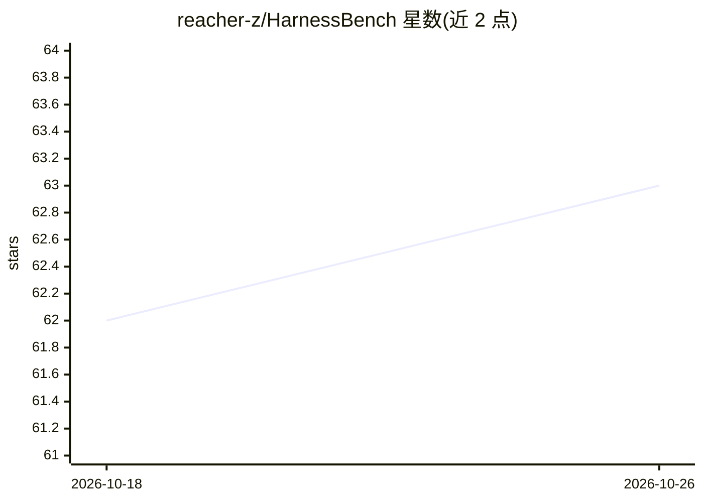

# reacher-z/HarnessBench

⭐ 63 · Python · Apache-2.0 · 推送 2026-07-17 · [GitHub](https://github.com/reacher-z/HarnessBench) · [官网](https://pypi.org/project/harness-bench/) · 组织维护 · 中文 README

**固定基座模型、对比 6 种 agent harness 的评测基准**

面向 agent harness 的评测基准：在 153 个日常线上任务（点餐、订票、求职等）上固定同一基座模型，横向对比 6 个 harness（openclaw、hermes、claw-code、browser-use、stagehand、coze-studio），覆盖 Python/Node/Rust/Web 四种运行时，每个 harness 独立容器运行。复用姊妹项目 ClawBench 的评测流水线（DOM-match + LLM judge）与五层录制格式。云端 harness 通过环境变量 opt-in，无凭据时标记跳过。以 PyPI CLI 工具提供，需 Python 3.10+、uv 与 Docker 或 Podman。排行榜数字为占位符，官方运行仍在进行中。

## 筛选速览

| 维度 | 判定 | 备注 |
|---|---|---|
| AI 角色 | `ai-ecosystem` | LLM/agent 周边工具 |
| 许可风险 | `permissive` | Apache-2.0 |
| 部署形态 | `self-host` | docker 或自建部署 |
| 模型依赖 | — | README 未给出锁定关系 |
| 硬件要求 | — | 无带数字的原话,不猜 |
| 安装摩擦 | `low` | 无编译、无系统依赖或容器化 |
| 成熟度 | `idea` | |

## 能力要点

- 固定基座模型、横向对比 6 个 harness（4 种运行时）
- 复用 ClawBench 的评测流水线与五层录制格式，输出可被同一分析脚本处理
- 每个 harness 独立容器（3 文件适配器），支持插件 entry-point 注册新 harness
- 提供 20 任务 Lite 子集（约 120 三元组）降低全矩阵成本

## 适用场景

- 评测团队横向对比多个 agent harness 在同一任务集上的表现
- harness 开发者用固定模型回归验证自己的 agent loop
- 为选型收集 harness 维度的可复现评测数据

## 场景标签

`模型评测` · 领域:评测与运维

## 证据(README 行号)

> L7:  The Benchmark for Comparing Agent Harnesses on Everyday Online Tasks
> L42: **6** harnesses &nbsp;&middot;&nbsp; **4** runtimes (Python / Node / Rust / Web) &nbsp;&middot;&nbsp; **153** share
> L38: Given one task (order food, book travel, apply for a job) and **one fixed base model** --

## 星数曲线

2026-10-18 62 → 2026-10-26 63（+1）

---
*卡片 v1 · prompt 1.4 · 生成 2026-10-24 · 置信度 mid · 依据 README sha `7ab62a168253` · [字段定义](../../DATASET.md)*
