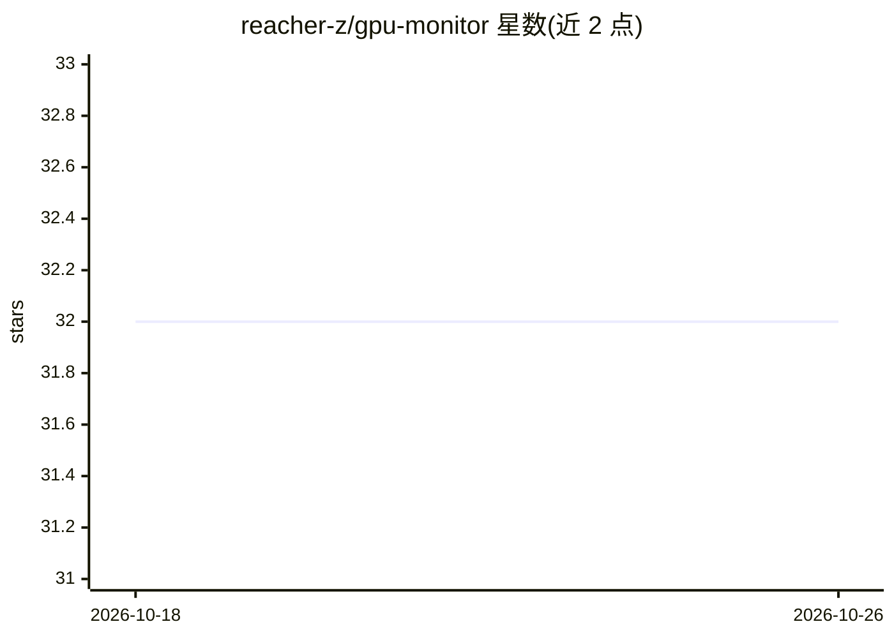

# reacher-z/gpu-monitor

⭐ 32 · Python · MIT · 推送 2026-03-08 · [GitHub](https://github.com/reacher-z/gpu-monitor) · [官网](https://reacher-z.github.io/gpu-monitor/) · 个人维护 · 中文 README

**NVIDIA GPU 训练监控告警工具：崩溃/过热/OOM 即时通知**

面向 ML 工程师的 NVIDIA GPU 后台监控工具：单 Python 文件、仅用标准库，轮询 GPU 状态并检测训练进程退出（全部空闲）、温度超限、内存泄漏、OOM 前兆、ECC 错误、风扇故障、PCIe 掉卡等事件，通过 Slack/Discord/Telegram 等内置 20 个通道（Apprise 可扩展 80+）发送告警。支持 --watch 终端实时表、--json 输出、Prometheus /metrics、InfluxDB/Datadog/OTLP 导出、Alertmanager webhook、systemd、Kubernetes DaemonSet 与 GitHub Pages 多机面板。需 Python 3.10+ 与 NVIDIA GPU 环境。

## 筛选速览

| 维度 | 判定 | 备注 |
|---|---|---|
| AI 角色 | `ai-ecosystem` | LLM/agent 周边工具 |
| 许可风险 | `permissive` | MIT |
| 部署形态 | `self-host` | docker 或自建部署 |
| 模型依赖 | — | README 未给出锁定关系 |
| 硬件要求 | — | 无带数字的原话,不猜 |
| 安装摩擦 | `low` | 无编译、无系统依赖或容器化 |
| 成熟度 | — | 结构信号不足 |

## 能力要点

- 单文件、零依赖（仅标准库），20 个内置通知通道
- 崩溃检测、温度/ECC/内存泄漏/OOM 前兆/风扇故障等告警
- Prometheus /metrics（11 指标）、InfluxDB/Datadog/OTLP 导出
- Kubernetes DaemonSet 与 systemd 部署，GitHub Pages 多机面板

## 适用场景

- 夜间训练任务崩溃时第一时间收到 Slack/Discord 通知
- 多卡服务器上发现挂死 worker 或静默内存泄漏
- 为 GPU 集群接入 Prometheus/Grafana 告警链路

## 场景标签

`MLOps` · 领域:训练与推理

## 证据(README 行号)

> L10: **Your training crashed at 3AM. Six hours of wasted compute. You find out in the morning.**
> L206: - **Crash detection** — GPUs suddenly go idle while processes were running → instant alert
> L240: - **Kubernetes DaemonSet** — deploy to every GPU node with `kubectl apply -k kubernetes/`

## 星数曲线

2026-10-18 32 → 2026-10-26 32（+0）

---
*卡片 v1 · prompt 1.4 · 生成 2026-10-25 · 置信度 high · 依据 README sha `5c7d9af428e5` · [字段定义](../../DATASET.md)*
