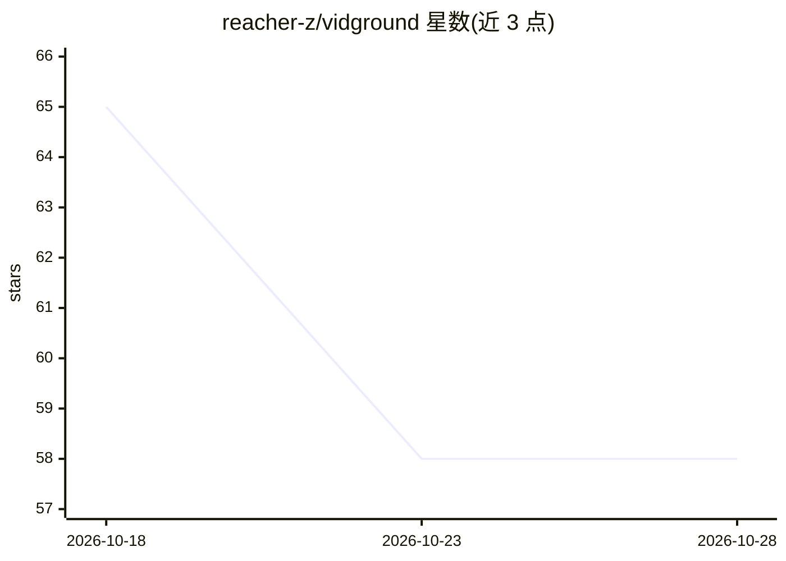

# reacher-z/vidground

⭐ 58 · Python · MIT · 推送 2026-09-15 · [GitHub](https://github.com/reacher-z/vidground) · [官网](https://arxiv.org/abs/2604.05117) · 组织维护

**给 VLM 研究者：筛选需视觉证据的训练/评测数据集**

论文《Watch Before You Answer: Learning from Visually Grounded Post-Training》的代码发布，本体是一个确定性的数据集筛选组件：用户自行运行文本-only 探针模型并保存预测日志，本包读取 JSONL 探针输出，通过 Unicode 感知的答案匹配核验哪些问题不依赖视频即可作答，保留需要视觉证据的样本，并输出机器可读的审计记录。不下载模型、不调用 API，训练启动器与论文评测运行器未包含，数据集与论文指标也不随仓库分发。仅可从 GitHub 源码安装，PyPI 当前不可用。

## 筛选速览

| 维度 | 判定 | 备注 |
|---|---|---|
| AI 角色 | `ai-ecosystem` | LLM/agent 周边工具 |
| 许可风险 | `permissive` | MIT |
| 部署形态 | `library` | 以包/库形式分发 |
| 模型依赖 | — | README 未给出锁定关系 |
| 硬件要求 | — | 无带数字的原话,不猜 |
| 安装摩擦 | `low` | 无编译、无系统依赖或容器化 |
| 成熟度 | — | 结构信号不足 |

## 能力要点

- JSONL 探针日志筛选：保留需视觉证据的样本
- Unicode 感知的精确答案匹配与探针覆盖率检查
- 每次筛选运行输出机器可读审计记录，文件原子写入
- 提供 vidground-filter CLI 与 Python 库两种使用方式

## 适用场景

- 从视频问答数据集中剔除不看视频也能答对的问题
- 后训练前对视频数据集做视觉依据审计
- 复现论文数据筛选流程的确定性部分

## 场景标签

 · 领域:视觉语言模型/数据集构建

## 证据(README 行号)

> L16: The released package is a deterministic curation component. It does not
> L23: - A validated JSONL filter for audited text-only probe outputs.
> L145: The repository does not redistribute the datasets used in the paper or claim

## 星数曲线

2026-10-18 65 → 2026-10-28 58（-7）

---
*卡片 v1 · prompt 1.4 · 生成 2026-10-24 · 置信度 mid · 依据 README sha `b4dba4b55b05` · [字段定义](../../DATASET.md)*
