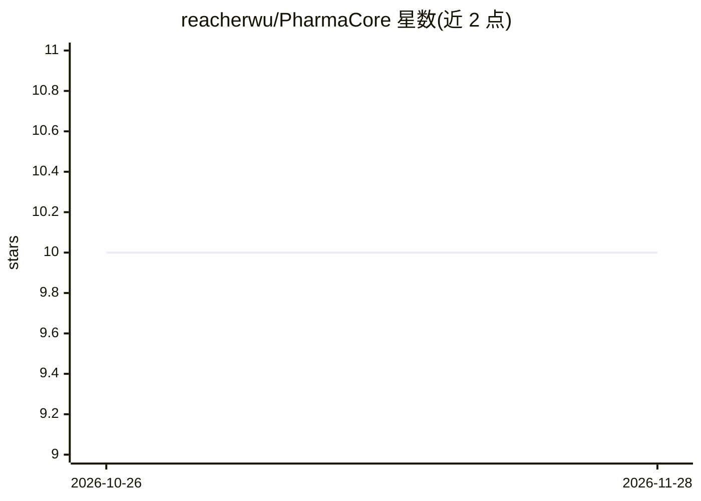

# reacherwu/PharmaCore

⭐ 10 · Python · Apache-2.0 · 推送 2026-08-24 · [GitHub](https://github.com/reacherwu/PharmaCore) · 个人维护

**在 Apple Silicon 上本地运行的 AI 药物发现工具**

PharmaCore 面向无法负担云端 GPU 集群的小型生物技术团队与学术实验室，在单台 Mac 上提供两项能力：针对给定蛋白靶点生成新候选分子（约 7 秒生成 5 个分子）、对现有 FDA 批准药物进行新用途重定位筛选（约 18 秒完成 12 药筛选）。评分基于 QED、Ertl 合成可及性、Lipinski/Veber 规则、Morgan 指纹相似度等可测量属性，并提供带 JSON 审计记录的完整可复现流程。使用幅度剪枝的稀疏模型（50% 稀疏度）运行于 PyTorch MPS，无需网络与 NVIDIA GPU。

## 筛选速览

| 维度 | 判定 | 备注 |
|---|---|---|
| AI 角色 | `ai-native` | 本体是模型或模型工具 |
| 许可风险 | `permissive` | Apache-2.0 |
| 部署形态 | `None` |  |
| 模型依赖 | — | README 未给出锁定关系 |
| 硬件要求 | — | 无带数字的原话,不猜 |
| 安装摩擦 | `low` | 无编译、无系统依赖或容器化 |
| 成熟度 | — | 结构信号不足 |

## 能力要点

- De novo 生成新候选分子与 FDA 药物重定位筛选两项能力
- 全部推理在 Apple Silicon MPS 上本地运行，无需云 API 与互联网
- 稀疏模型（ESM-2 8M/35M、ChemBERTa，50% 剪枝）发布于 HuggingFace
- AuditedDiscovery 管道输出完整 JSON 审计记录以支持复现

## 适用场景

- 在无 GPU 集群预算的实验室做靶点驱动的新分子生成
- 对已有 FDA 批准药物批量筛选潜在新适应症
- 在本地环境处理敏感化合物/患者数据而不外传
- 需要可审计、可复现打分记录的早期药物筛选流程

## 场景标签

`科研工具` · 领域:学习与行业

## 证据(README 行号)

> L19: PharmaCore brings AI-powered drug discovery to a single Mac mini. Two core capabilities:
> L23: |🧬 **De Novo Discovery**|Generate novel drug candidates for any protein target|~7s for 5 molecules|
> L26: Everything runs on Apple Silicon MPS — no NVIDIA GPU, no cloud API, no internet required.

## 星数曲线

2026-10-26 10 → 2026-11-28 10（+0）

---
*卡片 v1 · prompt 1.4 · 生成 2026-11-19 · 置信度 high · 依据 README sha `96a6f481f61a` · [字段定义](../../DATASET.md)*
