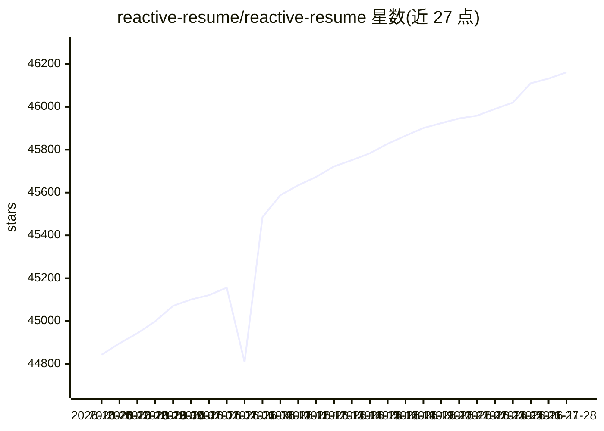

# reactive-resume/reactive-resume

⭐ 46,161 · TypeScript · MIT · 推送 2026-11-27 · [GitHub](https://github.com/reactive-resume/reactive-resume) · [官网](https://rxresu.me) · 组织维护

**求职者用的开源简历构建器，支持自托管与可选 AI 助手**

免费开源的简历与求职信构建器：提供 Write/Design/Check 三模式编辑器、18 套模板、实时 PDF 预览、自动保存与版本历史；支持简历检查（可读性、职位关键词匹配、可选 AI 写作审阅）、求职申请跟踪、多格式导入导出（PDF/Word/Markdown/JSON）与密码保护的公开分享。AI 功能为可选，需自行接入 provider（OpenAI/Anthropic/Gemini/OpenRouter/Ollama 等）。可自托管于 Docker、Vercel、Cloudflare Workers，附 REST API 与 MCP server。MIT 许可，无追踪与付费层。

## 筛选速览

| 维度 | 判定 | 备注 |
|---|---|---|
| AI 角色 | `ai-enhanced` | 去掉 AI 部分产品仍成立 |
| 许可风险 | `permissive` | MIT |
| 部署形态 | `self-host` | docker 或自建部署 |
| 模型依赖 | local-ok | 支持本地模型 |
| 硬件要求 | — | 无带数字的原话,不猜 |
| 安装摩擦 | `low` | 无编译、无系统依赖或容器化 |
| 成熟度 | — | 结构信号不足 |

## 动量与使用信号

- 维护:`active` — 距上次 push 0.7 天,年发版 49,234 位贡献者
- 涨星:近 1 天 **+69**(自 20261016 起算)
- 平台:— · 协议:MCP / OLLAMA

## 能力要点

- 18 套模板与 ATS-safe 筛选，支持 Semantic CSS 自定义样式
- 可选 AI 助手，支持接入 Ollama、OpenRouter 等多个 provider
- 提供 REST API 与 MCP server 做文档管理与导入导出
- 求职申请跟踪：List/Board/Insights/Calendar 视图

## 适用场景

- 自托管搭建隐私可控的在线简历制作服务
- 针对职位描述定制简历并起草求职信
- 跟踪求职申请的面试日程与进展
- 在浏览器内检查导出 PDF 的 ATS 可读性

## 场景标签

`AI 写作` · 领域:内容生成

## 证据(README 行号)

> L7:  Reactive Resume is a free and open-source resume builder for writing resumes and cover letters, checking your work,
> L51: You own your data. The codebase is open source under the MIT license, with no tracking, no ads, and no paid tier. O
> L111: - Connect OpenAI, Anthropic, Google Gemini, OpenRouter, Ollama, or other supported providers and compatible endpoi

## 星数曲线

2026-10-26 44,843 → 2026-11-28 46,161（+1,318）

---
*卡片 v1 · prompt 1.4 · 生成 2026-11-28 · 置信度 high · 依据 README sha `352e9e8a985b` · [字段定义](../../DATASET.md)*
