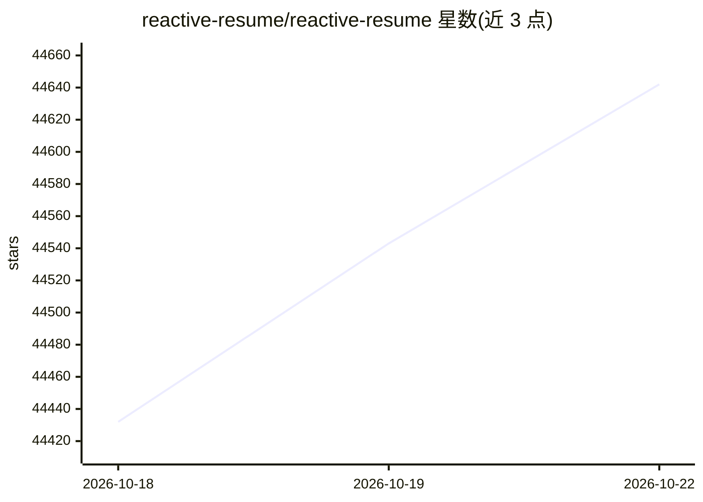

# reactive-resume/reactive-resume

⭐ 44,642 · TypeScript · MIT · 推送 2026-10-21 · [GitHub](https://github.com/reactive-resume/reactive-resume) · [官网](https://rxresu.me) · 组织维护

**开源自托管简历构建器：写简历、检查、投递追踪与可选 AI 助手**

面向求职者的免费开源简历/求职信构建器：提供所见即所得编辑器、18 套模板、可读性检查、职位关键词匹配、求职申请看板与日历追踪，导出 PDF/Word/Markdown/JSON 并支持公开链接分享。AI 为可选功能：文档旁助手可提出编辑建议（逐条接受/拒绝）、写作审阅、根据职位起草求职信，需自行连接 OpenAI、Anthropic、Gemini、OpenRouter、Ollama 等提供商；JSON/LinkedIn/PDF 导入不依赖 AI，Word 导入需连接提供商。可自托管（Docker、Vercel、Cloudflare Workers 等），MIT 许可，无跟踪无广告。

## 筛选速览

| 维度 | 判定 | 备注 |
|---|---|---|
| AI 角色 | `ai-enhanced` | 去掉 AI 部分产品仍成立 |
| 许可风险 | `permissive` | MIT |
| 部署形态 | `self-host` | docker 或自建部署 |
| 模型依赖 | local-ok | 支持本地模型 |
| 硬件要求 | — | 无带数字的原话,不猜 |
| 安装摩擦 | `low` | 无编译、无系统依赖或容器化 |
| 成熟度 | — | 结构信号不足 |

## 动量与使用信号

- 维护:`active` — 距上次 push 0.7 天,年发版 49,234 位贡献者
- 涨星:近 1 天 **+69**(自 20261016 起算)
- 平台:— · 协议:MCP / OLLAMA

## 能力要点

- 18 套模板与 ATS 友好筛选，实时 PDF 预览
- 可读性检查、职位关键词匹配与浏览器端公开 ATS 检查器
- 可选 AI 助手：提议式编辑、写作审阅、按职位起草求职信，需自接提供商
- 求职申请追踪（列表/看板/洞察/日历）与 REST API、MCP server

## 适用场景

- 编写和定制简历，导出 PDF/Word/Markdown 并公开分享
- 对照职位描述检查简历关键词匹配与可读性
- 追踪投递进度、面试安排与联系人
- 在自己服务器上自托管完整应用，掌控数据

## 场景标签

 · 领域:求职/文档工具

## 证据(README 行号)

> L12:  Reactive Resume is a free and open-source resume builder for writing resumes and cover letters, checking your work
> L47: You own your data. The codebase is open source under the MIT license, with no tracking, no ads, and no paid tier. O
> L107: - Connect OpenAI, Anthropic, Google Gemini, OpenRouter, Ollama, or other supported providers and compatible endpoi
> L113: - JSON, LinkedIn, and readable PDF imports work without AI; Word imports require a connected provider

## 星数曲线

2026-10-18 44,432 → 2026-10-22 44,642（+210）

---
*卡片 v1 · prompt 1.4 · 生成 2026-10-20 · 置信度 high · 依据 README sha `2602fafa4a22` · [字段定义](../../DATASET.md)*
