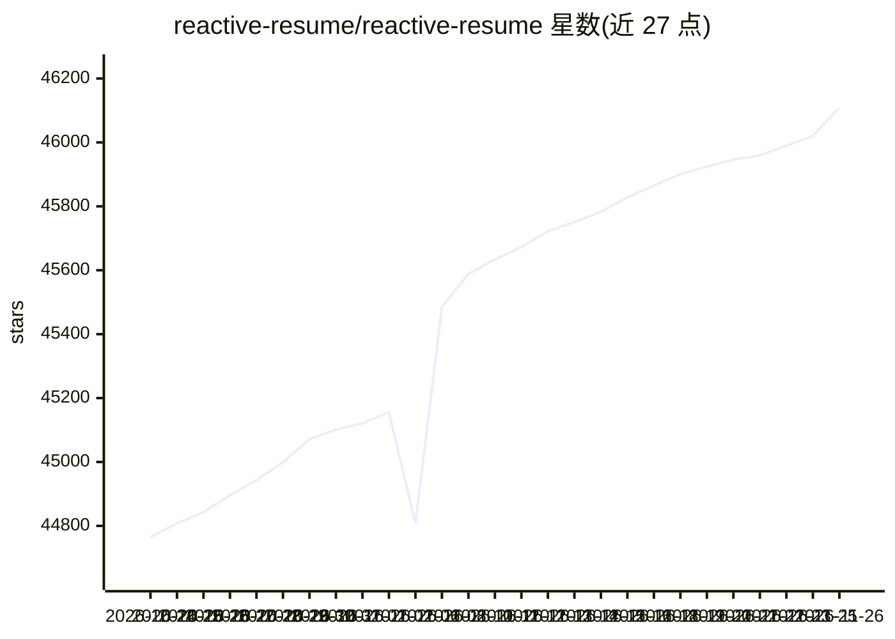

# reactive-resume/reactive-resume

⭐ 46,110 · TypeScript · MIT · 推送 2026-11-20 · [GitHub](https://github.com/reactive-resume/reactive-resume) · [官网](https://rxresu.me) · 个人维护

**面向求职者的开源简历与求职信构建器，可自托管**

Reactive Resume 是一个免费开源的简历与求职信构建器：提供所见即所得编辑器、18 套模板、实时 PDF 预览、可读性检查与职位关键词匹配、求职申请追踪看板，以及 PDF/Word/Markdown/JSON 导出和带密码保护的公开分享链接。可选 AI 功能包括写作助理、AI 简历审阅与求职信起草，用户需自行接入 OpenAI、Ollama 等服务商；文档管理通过 REST API 与 MCP server 开放。支持 Docker、Vercel、Cloudflare Workers 等自托管方式，MIT 许可，无追踪无广告。

## 筛选速览

| 维度 | 判定 | 备注 |
|---|---|---|
| AI 角色 | `ai-enhanced` | 去掉 AI 部分产品仍成立 |
| 许可风险 | `permissive` | MIT |
| 部署形态 | `self-host` | docker 或自建部署 |
| 模型依赖 | local-ok | 支持本地模型 |
| 硬件要求 | — | 无带数字的原话,不猜 |
| 安装摩擦 | `low` | 无编译、无系统依赖或容器化 |
| 成熟度 | — | 结构信号不足 |

## 动量与使用信号

- 维护:`active` — 距上次 push 0.7 天,年发版 49,234 位贡献者
- 涨星:近 1 天 **+69**(自 20261016 起算)
- 平台:— · 协议:MCP / OLLAMA

## 能力要点

- 18 套模板，含 ATS-safe 过滤与 Semantic CSS 自定义样式
- AI 助理可接入 OpenAI/Anthropic/Gemini/OpenRouter/Ollama 等，建议式修改逐条接受或拒绝
- 求职申请追踪：列表/看板/洞察/日历视图，支持 CSV 导入导出
- 提供 REST API 与 MCP server 用于文档管理、导入导出与检查

## 适用场景

- 在线编写并导出 PDF/Word 简历与求职信
- 在浏览器中用 ATS 检查器核查 PDF 简历
- 自托管在自有基础设施上管理简历数据
- 追踪求职申请从 Saved 到 Offer 的流程

## 场景标签

`AI 写作` · 领域:内容生成

## 证据(README 行号)

> L7:  Reactive Resume is a free and open-source resume builder for writing resumes and cover letters, checking your work,
> L106: **AI Assistant**
> L124: - Self-host with Docker, Vercel, Cloudflare Workers, or a 1-click deploy on Hostinger

## 星数曲线

2026-10-24 44,765 → 2026-11-26 46,110（+1,345）

---
*卡片 v1 · prompt 1.4 · 生成 2026-11-22 · 置信度 high · 依据 README sha `a566d35e54d0` · [字段定义](../../DATASET.md)*
