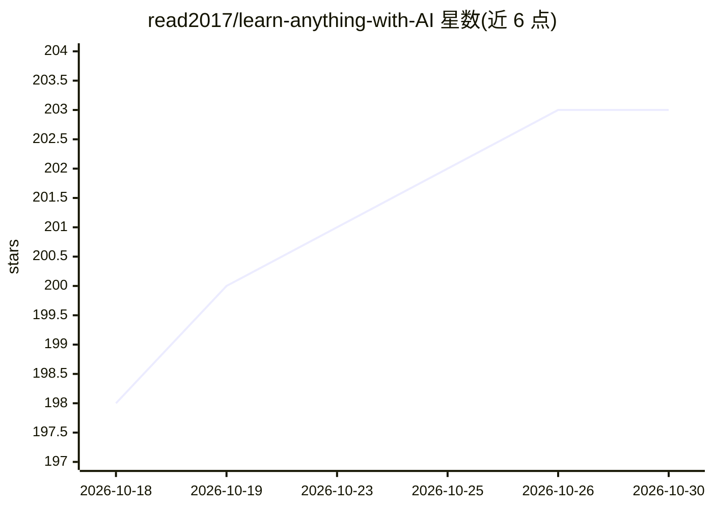

# read2017/learn-anything-with-AI

⭐ 203 · Python · MIT · 推送 2026-10-02 · [GitHub](https://github.com/read2017/learn-anything-with-AI) · [官网](https://xhslink.cn/o/5pRBmwGVkJe) · 个人维护 · 中文 README

**可移植的 SKILL.md 学习工作流包：让 AI 带用户系统学会任意主题**

单个可移植的 SKILL.md 工作流包（含 references 与 assets），在 Codex / Claude Code / OpenCode 等 agent 工具中以「导师 + 项目教练」角色运行：先诊断学习起点，生成学习路线，组织项目化练习（编程主题做最小 demo/微项目，非编程主题做研究短报告/知识地图等），执行掌握度检查，并把学习计划、笔记、复盘、错题记录写入当前目录的 study/ 子目录的 Markdown 文件。来源策略优先官方文档与权威材料。面向想系统学习新主题并通过项目化推进到会用的个人，通过 npx skills add 安装。

## 筛选速览

| 维度 | 判定 | 备注 |
|---|---|---|
| AI 角色 | `ai-ecosystem` | LLM/agent 周边工具 |
| 许可风险 | `permissive` | MIT |
| 部署形态 | `library` | 以包/库形式分发 |
| 模型依赖 | — | README 未给出锁定关系 |
| 硬件要求 | — | 无带数字的原话,不猜 |
| 安装摩擦 | `low` | 无编译、无系统依赖或容器化 |
| 成熟度 | — | 结构信号不足 |

## 能力要点

- SKILL.md 单文件工作流，可在 Codex / Claude Code / OpenCode 间迁移
- 诊断起点 → 学习路线 → 项目化练习 → 掌握度检查的教学闭环
- 学习产出落盘为 study/ 子目录下的 Markdown 文件
- 来源策略优先官方文档/权威材料，并区分事实依据与建议判断

## 适用场景

- 让 AI 按项目驱动方式带我系统学习一门新主题
- 把学习计划、笔记与复盘沉淀为可复盘的 Markdown 文件
- 定制自己的 Skill 版本（换语气、项目风格、资料策略）并开源复用

## 场景标签

 · 领域:教育/AI 工作流

## 证据(README 行号)

> L35: `learn-anything-skill` 是一个可移植的 `SKILL.md` 工作流包，核心目标不是“回答问题”，而是 **帮助用户真的学会**。
> L165: - **OpenAI / Codex / ChatGPT Skills**：这是最原生的目标形态
> L170: 换句话说：这个仓库的核心资产是通用的 `SKILL.md + references + assets` 工作流；不同代理工具的安装入口不完全一样，但内容本身是可迁移的。

## 星数曲线

2026-10-18 198 → 2026-10-30 203（+5）

---
*卡片 v1 · prompt 1.4 · 生成 2026-10-23 · 置信度 high · 依据 README sha `2e8cae22dc55` · [字段定义](../../DATASET.md)*
