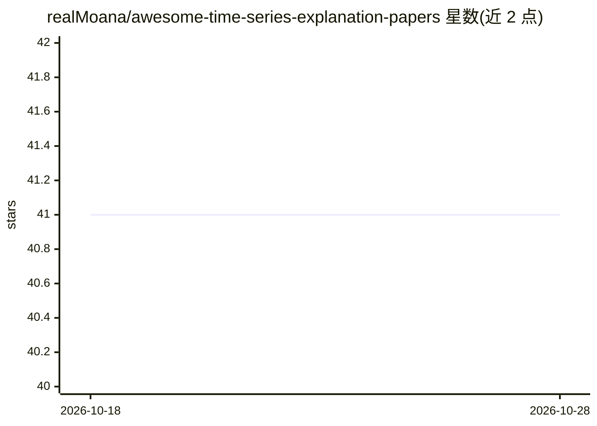

# realMoana/awesome-time-series-explanation-papers

⭐ 41 · MIT · 推送 2026-08-23 · [GitHub](https://github.com/realMoana/awesome-time-series-explanation-papers) · 组织维护 · 中文 README

**时序可解释性研究论文清单：面向研究者的文献导航**

随附综述论文《From Signals to Semantics》维护的时序解释与可解释性研究论文合集：将方法按信号空间、模式空间、结构、语义四个认知层级组织，覆盖预测、分类、异常检测、因果发现等任务的解释方法。设 LLM/VLM/MLLM 专类收录基于大模型的语义解释论文（TimeOmni、Chat-TS、AXIS 等），另含综述、数据集与评测基准条目，条目按时间排列。面向研究人员与从业者，无安装运行内容。

## 筛选速览

| 维度 | 判定 | 备注 |
|---|---|---|
| AI 角色 | `ai-knowledge` | 知识聚合/清单类 |
| 许可风险 | `permissive` | MIT |
| 部署形态 | `None` |  |
| 模型依赖 | — | README 未给出锁定关系 |
| 硬件要求 | — | 无带数字的原话,不猜 |
| 安装摩擦 | `low` | 无编译、无系统依赖或容器化 |
| 成熟度 | — | 结构信号不足 |

## 能力要点

- 按四个认知层级组织时序解释方法
- LLM/VLM/MLLM 专类收录大模型语义解释论文
- 收录综述与解释评测数据集/基准
- 条目按年份排列以追踪方法演进

## 适用场景

- 入门时序可解释性领域并查找综述
- 查找 LLM/VLM 驱动的时序语义解释论文
- 为解释方法评测寻找基准与数据集

## 场景标签

`科研工具` `精选清单` · 领域:学习与行业

## 证据(README 行号)

> L4: A curated and continuously updated collection of **time series explanation and interpretability** research, covering
> L63: ### LLM/VLM/MLLM

## 星数曲线

2026-10-18 41 → 2026-10-28 41（+0）

---
*卡片 v1 · prompt 1.4 · 生成 2026-10-25 · 置信度 high · 依据 README sha `83ea3e0bad06` · [字段定义](../../DATASET.md)*
