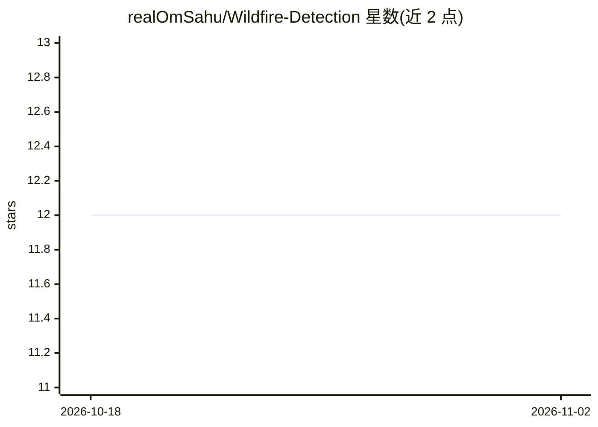

# realOmSahu/Wildfire-Detection

⭐ 12 · Jupyter Notebook · Apache-2.0 · 推送 2026-10-10 · [GitHub](https://github.com/realOmSahu/Wildfire-Detection) · 个人维护

**基于深度学习的野火探测系统：卫星/相机图像与气象数据预测火险**

Flask Web 应用，整合三类模型：基于 ResNet50v2 的卫星图像野火概率分类（README 标注 97% 准确率）、基于 ResNet50v2 的上传图像火焰识别（98%）、气象数据火险预测模型。提供小时级邮件预警订阅（MailerSend）、地图展示（Mapbox token）与 OpenMeteo 气象数据接入。模型训练在 Kaggle Notebook 中完成，需配置 .env 环境变量后本地运行 Flask 应用。

## 筛选速览

| 维度 | 判定 | 备注 |
|---|---|---|
| AI 角色 | `ai-native` | 本体是模型或模型工具 |
| 许可风险 | `permissive` | Apache-2.0 |
| 部署形态 | `library` | 以包/库形式分发 |
| 模型依赖 | — | README 未给出锁定关系 |
| 硬件要求 | — | 无带数字的原话,不猜 |
| 安装摩擦 | `low` | 无编译、无系统依赖或容器化 |
| 成熟度 | — | 结构信号不足 |

## 能力要点

- ResNet50v2 卫星图像野火分类 CNN
- 上传图像（相机/无人机）火焰识别
- 气象数据驱动的火险预测
- 小时级邮件预警订阅服务

## 适用场景

- 上传相机或无人机图像判断是否出现火焰
- 分析卫星数据定位野火热点
- 订阅指定地区的野火风险邮件预警

## 场景标签

`目标检测` · 领域:感知与多模态

## 证据(README 行号)

> L40: This project presents an innovative solution combining satellite imagery, camera feeds, and weather data to predict
> L43: - **Satellite Classification CNN**: Using ResNet50v2, this model detects wildfire probabilities from satellite imag

## 星数曲线

2026-10-18 12 → 2026-11-02 12（+0）

---
*卡片 v1 · prompt 1.4 · 生成 2026-11-01 · 置信度 mid · 依据 README sha `b19cf303516b` · [字段定义](../../DATASET.md)*
