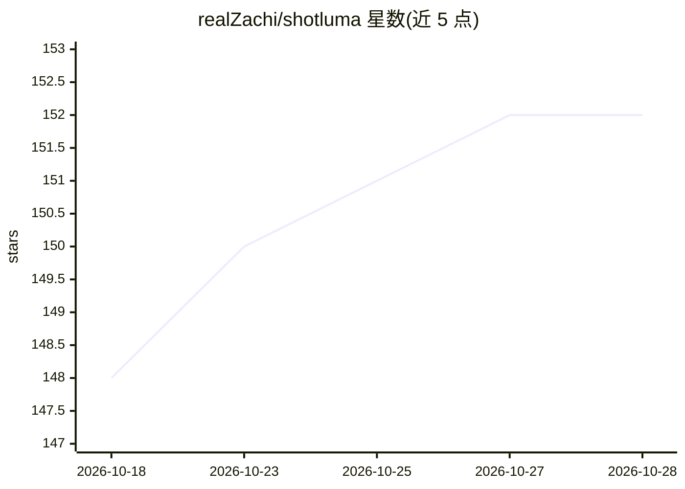

# realZachi/shotluma

⭐ 154 · TypeScript · MIT · 推送 2026-10-19 · [GitHub](https://github.com/realZachi/shotluma) · [官网](https://shotluma.com) · 个人维护

**浏览器内本地优先的 iOS 截图画布编辑器，AI agent 生成可编辑设计**

在浏览器中运行的画布编辑器，用于制作完整 iOS App Store 截图组：描述应用并上传原始截图后，AI agent 通过编辑器工具调用生成整套设计，所有文本层、渐变、形状与设备模型均为可选中编辑的真实画布元素，可单屏修改并按商店分辨率导出 ZIP。项目与上传存储在浏览器 IndexedDB，编辑功能无需 AI 凭据；AI 生成可通过本地 Codex 应用（复用 ChatGPT 订阅）或自备多家 provider API key。限制：生成文案仅英文，浏览器存储的 key 不加密。

## 筛选速览

| 维度 | 判定 | 备注 |
|---|---|---|
| AI 角色 | `ai-enhanced` | 去掉 AI 部分产品仍成立 |
| 许可风险 | `permissive` | MIT |
| 部署形态 | `None` |  |
| 模型依赖 | locked-api |  |
| 硬件要求 | — | 无带数字的原话,不猜 |
| 安装摩擦 | `low` | 无编译、无系统依赖或容器化 |
| 成熟度 | — | 结构信号不足 |

## 能力要点

- AI agent 经编辑器工具调用产出真实可编辑画布元素，支持单屏 AI 修改
- 本地优先：项目与上传存储在浏览器 IndexedDB，编辑器无需 AI 凭据
- 支持 Codex（复用 ChatGPT 订阅）或自备 Moonshot/Google/Qwen/OpenAI/Anthropic/xAI/OpenRouter 等 key
- 一键导出 1290×2796 / 1242×2688 PNG 整套 ZIP

## 适用场景

- 制作成套 App Store 截图并用 AI 生成初稿
- 上传原始截图放入带 3D 透视的设备模型
- 在本地浏览器中编辑并按商店分辨率导出整套截图

## 场景标签

`图像视频处理` · 领域:感知与多模态

## 证据(README 行号)

> L20: Projects live entirely in your browser — no Shotluma account or project backend. The editor itself works without AI
> L28: - **Direct manipulation** — typography, gradients, shapes, images, mockups, alignment, stacking, and spacing are al
> L30: - **Local-first** — projects and uploads are stored in IndexedDB in your browser.

## 星数曲线

2026-10-18 148 → 2026-10-28 152（+4）

---
*卡片 v1 · prompt 1.4 · 生成 2026-10-22 · 置信度 high · 依据 README sha `bc664fd522d0` · [字段定义](../../DATASET.md)*
