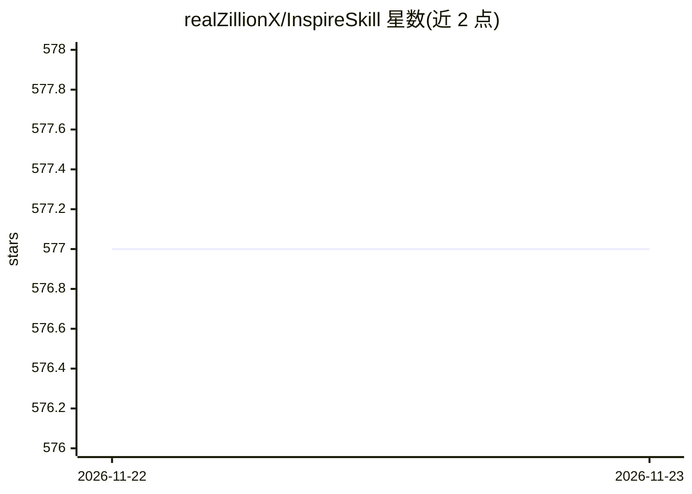

# realZillionX/InspireSkill

⭐ 577 · Python · MIT · 推送 2026-11-21 · [GitHub](https://github.com/realZillionX/InspireSkill) · 组织维护 · 中文 README

**让 AI Agent 经 CLI 调度启智平台算力的本地工具套件**

将启智（Inspire）平台 GUI 操作打平为 CLI 的本地工具套件，包含 inspire CLI、部署到 Agent 客户端的 SKILL.md 技能手册与同步/异步 Python SDK。覆盖 Notebook 连接与镜像固化、GPU Job / HPC / Ray 提交、Serving 部署、TensorBoard 曲线直读、日志事件监控与配额查询。安装脚本自动检测本机 Agent 客户端并写入技能文档；登录走 OAuth 设备授权，CAS 飞书/短信登录用于数据广场。对比对象为启智官方 QWorks 桌面客户端。

## 筛选速览

| 维度 | 判定 | 备注 |
|---|---|---|
| AI 角色 | `ai-ecosystem` | LLM/agent 周边工具 |
| 许可风险 | `permissive` | MIT |
| 部署形态 | `desktop` | 安装包/桌面程序 |
| 模型依赖 | — | README 未给出锁定关系 |
| 硬件要求 | — | 无带数字的原话,不猜 |
| 安装摩擦 | `low` | 无编译、无系统依赖或容器化 |
| 成熟度 | — | 结构信号不足 |

## 能力要点

- CLI + SKILL.md + Python SDK 三部分一体化，安装脚本自动部署到已检测到的 Agent 客户端
- 覆盖 Notebook SSH/scp、GPU Job、HPC（Slurm 双层规格预检）、Ray 弹性集群与 Serving 全生命周期管理
- tensorboard scalars 直读曲线数据，供 Agent 判断 loss 收敛与指标走势
- 多账号管理与 OAuth/CAS 双认证，令牌本地 0600 权限存储，支持 --json 结构化输出

## 适用场景

- 在 Codex/Claude Code 等客户端中让 Agent 代为提交和追踪启智训练任务
- 科研学生批量管理 Notebook、共享盘代码同步与闲置资源清理
- 在终端直接查询 8 卡整节点空闲量与低优任务占用
- 用脚本编排 --json 命令做矩阵实验巡检与 Serving 扩缩容

## 场景标签

`科研工具` `MLOps` · 领域:学习与行业

## 证据(README 行号)

> L1: Inspire Skill: the Agent-Native cockpit for the Inspire compute platform
> L11: 本着过渡到大 Agent 时代、将一切重复性机械工作交给 Agent 的初衷，我们创办了 InspireSkill 项目，旨在将启智平台 GUI 打平为 CLI，并建立了 CLI + Skill 的一体化系统，让 InspireS
> L21: - **`inspire` CLI**：把资源查询、Notebook 连接、GPU Job / HPC / Ray 提交、Serving 部署、TensorBoard 曲线读取、镜像与模型管理整合为命令行工具。所有资源直接按名称和

## 星数曲线

2026-11-22 577 → 2026-11-23 577（+0）

---
*卡片 v1 · prompt 1.4 · 生成 2026-11-22 · 置信度 high · 依据 README sha `66b0bd69b857` · [字段定义](../../DATASET.md)*
