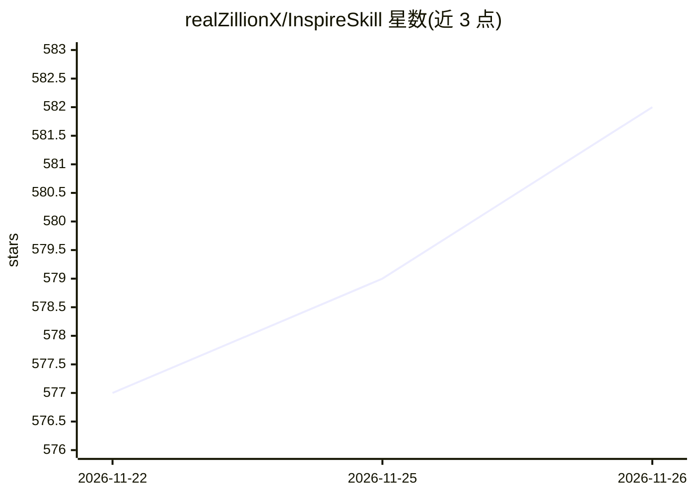

# realZillionX/InspireSkill

⭐ 582 · Python · MIT · 推送 2026-11-21 · [GitHub](https://github.com/realZillionX/InspireSkill) · 组织维护 · 中文 README

**给启智平台科研用户：把算力操作搬进本地 CLI 与 AI Agent**

面向上海创智学院启智（Inspire）计算平台用户的本地工具套件，由 inspire CLI、面向 Agent 的 SKILL.md 操作手册和 Python SDK（同步/异步客户端）组成。覆盖配额查询、Notebook 管理、单机/多机 GPU 训练提交、CPU Slurm 批处理、Ray 弹性集群、在线推理部署、镜像与模型注册、数据集挂载及 TensorBoard 指标直读。安装器自动将 Skill 文档写入本机检测到的 13 款 Agent 客户端目录；支持 macOS/Linux/原生 Windows，需 Python 3.10+，凭据本地隔离且不存明文密码。

## 筛选速览

| 维度 | 判定 | 备注 |
|---|---|---|
| AI 角色 | `ai-ecosystem` | LLM/agent 周边工具 |
| 许可风险 | `permissive` | MIT |
| 部署形态 | `desktop` | 安装包/桌面程序 |
| 模型依赖 | — | README 未给出锁定关系 |
| 硬件要求 | — | 无带数字的原话,不猜 |
| 安装摩擦 | `low` | 无编译、无系统依赖或容器化 |
| 成熟度 | — | 结构信号不足 |

## 能力要点

- CLI、SKILL.md 技能手册与 Python SDK 三件套统一封装平台操作
- 支持 13 款 Agent 客户端自动部署，所有命令带 --json 输出
- H100/H200 受限节点自动切换 JupyterTerminal 通道执行命令
- 提交前自动拦截物理配额与 Slurm 参数冲突

## 适用场景

- 在 Claude Code/Codex 里用对话提交和盯 GPU 训练任务
- 不打开浏览器直接查空闲 8 卡整节点和项目余额
- 终端直读 TensorBoard loss 判断训练是否收敛
- 校园网外配代理后继续管理平台任务

## 场景标签

`科研工具` · 领域:学习与行业

## 证据(README 行号)

> L22: **InspireSkill** 的目标，是把启智平台的全部操作搬进本地命令行，并配齐面向 AI Agent 的技能手册与 Python SDK。你不需要改变原有的开发习惯——继续在熟悉的 Codex、Claude Code、Cu
> L36: |**`SKILL.md`&nbsp;与&nbsp;`references/`**|面向 AI Agent 编排的操作规范与领域参考手册，涵盖任务选型、环境准备、实时巡检与清理闭环，由安装器自动部署至本机 Agent 客户端。|

## 星数曲线

2026-11-22 577 → 2026-11-26 582（+5）

---
*卡片 v1 · prompt 1.4 · 生成 2026-11-25 · 置信度 high · 依据 README sha `95316cbae165` · [字段定义](../../DATASET.md)*
