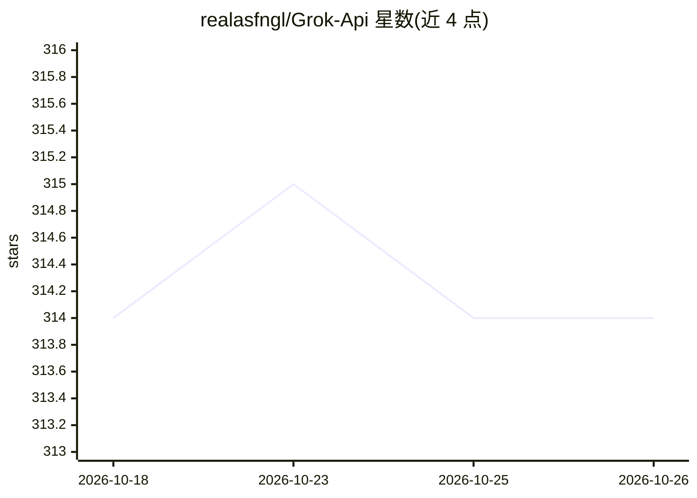

# realasfngl/Grok-Api

⭐ 314 · Python · 推送 2026-08-18 · [GitHub](https://github.com/realasfngl/Grok-Api) · 个人维护

**无需官方 API/账号的 Grok 逆向访问 Python 包装器**

基于 Python 的 Grok AI 逆向 API 包装器：绕过官方 API 与账号认证访问 Grok 对话服务，提供直接 Python 接口与 FastAPI REST 服务端，支持流式响应、HTTP 代理、多 worker 并发，可选 grok-3/grok-4 系列模型。README 首行声明项目已过时并停止维护，因无账号已无法与 Grok 对话；IP 可能触发反爬拦截，需更换代理。通过 git clone 源码安装，依赖 Python 3.10+ 与 curl_cffi、fastapi 等库。

## 筛选速览

| 维度 | 判定 | 备注 |
|---|---|---|
| AI 角色 | `ai-ecosystem` | LLM/agent 周边工具 |
| 许可风险 | `none` | — |
| 部署形态 | `library` | 以包/库形式分发 |
| 模型依赖 | — | README 未给出锁定关系 |
| 硬件要求 | — | 无带数字的原话,不猜 |
| 安装摩擦 | `low` | 无编译、无系统依赖或容器化 |
| 成熟度 | — | 结构信号不足 |

## 能力要点

- 免账号/免 API key 访问 Grok 对话（逆向方式）
- 提供 Python 接口与 FastAPI REST 服务端
- 支持流式响应、HTTP 代理与多 worker 并发
- 可选 grok-3-auto/fast、grok-4、grok-4-mini-thinking 等模式

## 适用场景

- 在没有官方 API key 的情况下调用 Grok 对话
- 将 Grok 以 REST 端点形式接入自己的应用
- 通过代理绕过 IP 限制访问 Grok

## 场景标签

 · 领域:LLM 接入/API 封装

## 证据(README 行号)

> L3: A free Grok API wrapper that allows you to use Grok without API access or account authentication.
> L9: This project provides a Python-based API wrapper for Grok AI, enabling you to interact with Grok's conversational AI
> L15: - 🚀 **FastAPI Server** - Ready-to-use REST API endpoint

## 星数曲线

2026-10-18 314 → 2026-10-26 314（+0）

---
*卡片 v1 · prompt 1.4 · 生成 2026-10-21 · 置信度 mid · 依据 README sha `f37fa3b982c7` · [字段定义](../../DATASET.md)*
