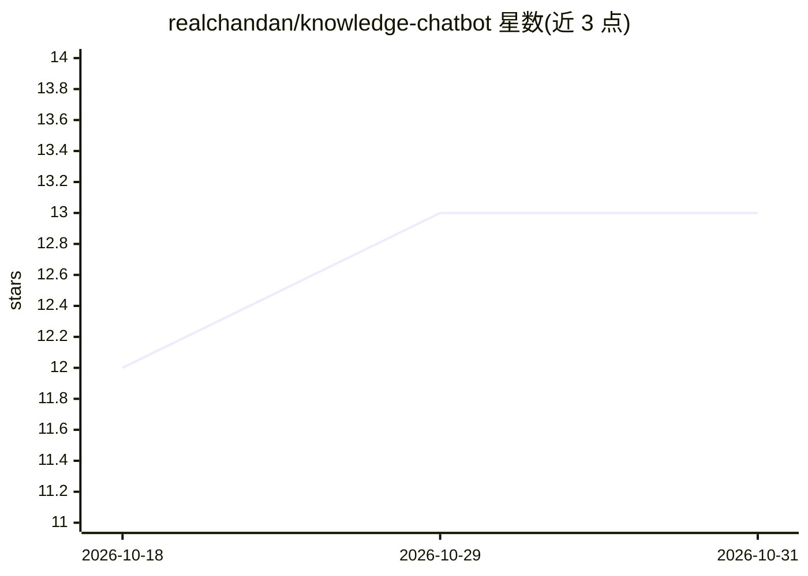

# realchandan/knowledge-chatbot

⭐ 13 · TypeScript · AGPL-3.0 · 推送 2026-08-29 · [GitHub](https://github.com/realchandan/knowledge-chatbot) · 个人维护

**部署在 Cloudflare 上的可嵌入网站问答聊天机器人**

开源、可嵌入的 AI 聊天机器人组件：将用户网站内容作为知识源，通过爬取与索引建立向量检索，访客以文本或语音就网站内容提问。全栈构建于 Cloudflare（Workers、D1、Durable Objects、Vectorize、Workers AI、Browser Rendering、KV、Assets），支持一键部署与自托管，无需独立后端服务器。README 声明预期破坏性变更、不保证向后兼容。采用 AGPLv3 许可。

## 筛选速览

| 维度 | 判定 | 备注 |
|---|---|---|
| AI 角色 | `ai-native` | 本体是模型或模型工具 |
| 许可风险 | `viral` | AGPL-3.0 |
| 部署形态 | `None` |  |
| 模型依赖 | — | README 未给出锁定关系 |
| 硬件要求 | — | 无带数字的原话,不猜 |
| 安装摩擦 | `low` | 无编译、无系统依赖或容器化 |
| 成熟度 | `idea` | |

## 能力要点

- 可嵌入网页的聊天组件，支持文本与语音对话
- 网站爬取、内容索引与 Cloudflare Vectorize 向量检索
- 全栈运行于 Cloudflare，无需独立后端服务器
- 一键部署到 Cloudflare 的自托管方案

## 适用场景

- 在自己的网站上嵌入客服式问答机器人
- 让访客通过对话查询网站内容
- 零成本（Cloudflare 免费额度）自托管站内知识问答

## 场景标签

`聊天机器人` `文档问答` · 领域:对话与助手

## 证据(README 行号)

> L5: A minimal, open-source, embeddable AI chatbot that answers questions from your website content via text or voice.
> L24: - AI inference through Cloudflare Workers AI

## 星数曲线

2026-10-18 12 → 2026-10-31 13（+1）

---
*卡片 v1 · prompt 1.4 · 生成 2026-10-31 · 置信度 high · 依据 README sha `bcea7b4d25d2` · [字段定义](../../DATASET.md)*
