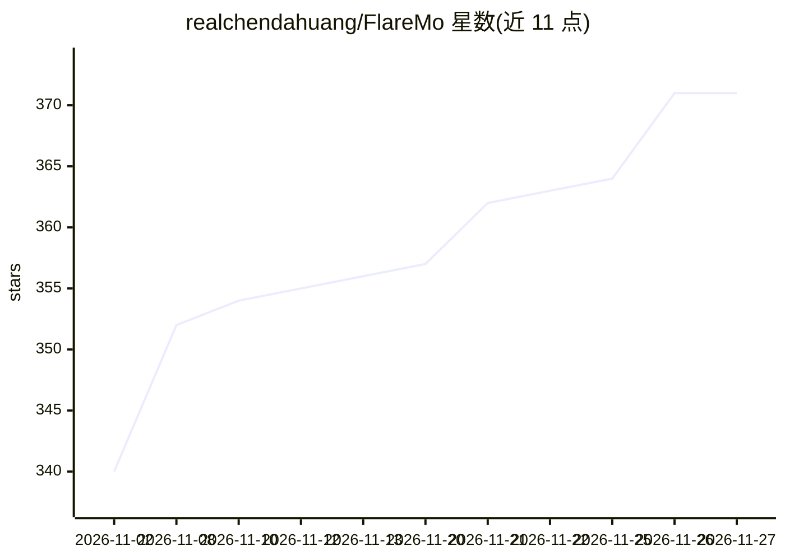

# realchendahuang/FlareMo

⭐ 371 · TypeScript · AGPL-3.0 · 推送 2026-11-22 · [GitHub](https://github.com/realchendahuang/FlareMo) · [官网](https://flaremo.app) · 个人维护 · 中文 README

**给个人与团队：在 Cloudflare 上零服务器运行的知识库与 AI Agent 笔记记忆**

部署在 Cloudflare Workers/D1/R2 上的笔记、任务与文章管理应用，定位为第二大脑与团队共享知识库。提供 FTS5 全文检索、Workers AI 嵌入加 Vectorize 的语义搜索、每日回顾、待办与看板、三级可见性团队空间、PWA 离线同步、Web Push 提醒。AI 侧通过 /mcp 端点与 flaremo-notes 技能，让外部 agent 对笔记执行搜索、读取与写入；agent 按需读取笔记，不自动抽取到独立记忆库。支持一键导出、API 兼容层与插件卡片系统。

## 筛选速览

| 维度 | 判定 | 备注 |
|---|---|---|
| AI 角色 | `ai-enhanced` | 去掉 AI 部分产品仍成立 |
| 许可风险 | `viral` | AGPL-3.0 |
| 部署形态 | `self-host` | docker 或自建部署 |
| 模型依赖 | — | README 未给出锁定关系 |
| 硬件要求 | — | 无带数字的原话,不猜 |
| 安装摩擦 | `low` | 无编译、无系统依赖或容器化 |
| 成熟度 | — | 结构信号不足 |

## 能力要点

- /mcp 端点提供笔记 list/search/read/create/update/delete，配 memos_pat_ 令牌鉴权
- Workers AI embeddings + Vectorize 语义搜索，可回退 FTS5
- 笔记-任务-文章流转与标签/反向链接图回顾
- 一键导出全量数据并自带迁移转换器

## 适用场景

- 部署个人第二大脑，零服务器维护笔记与待办
- 让 Claude Code/Cursor 等工具直接读写我的笔记
- 小团队共享空间发布与评论笔记
- 部署为 AI Agent 的长期记忆库

## 场景标签

`Agent 记忆` `知识库管理` `语义搜索` · 领域:Agent 开发

## 证据(README 行号)

> L4:  An AI-native second brain for you. A shared knowledge base for your team.
> L37: - **AI-native, not bolted on**: A notes MCP endpoint plus the `flaremo-notes` skill lets Claude, Cursor, Codex, Cha
> L38: - **Truly serverless**: code and static assets run on the Cloudflare Workers edge node nearest you; D1 and R2 hold 

## 星数曲线

2026-11-02 340 → 2026-11-27 371（+31）

---
*卡片 v1 · prompt 1.4 · 生成 2026-11-25 · 置信度 mid · 依据 README sha `456f732de5a9` · [字段定义](../../DATASET.md)*
