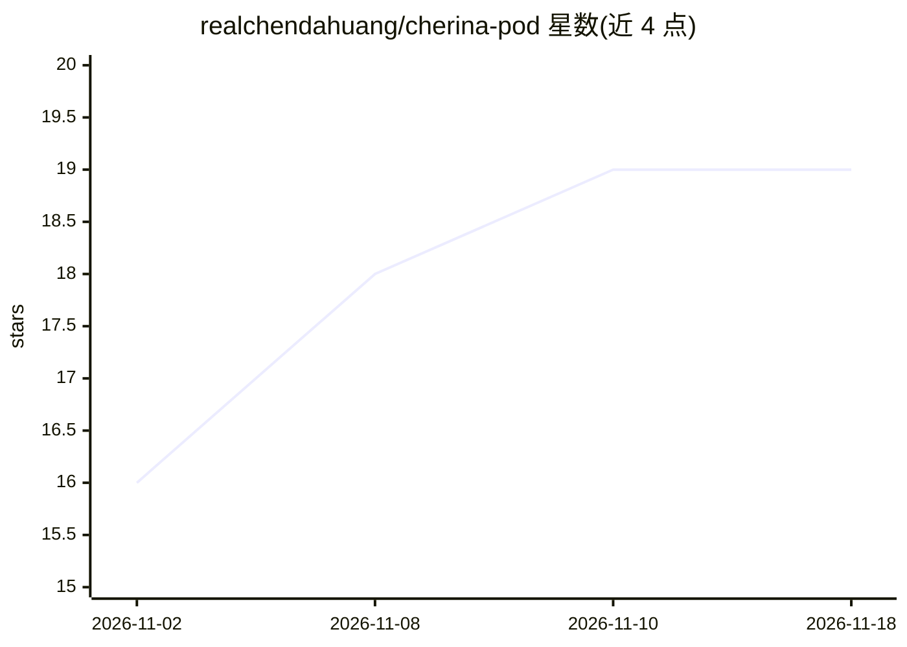

# realchendahuang/cherina-pod

⭐ 19 · Python · AGPL-3.0 · 推送 2026-10-31 · [GitHub](https://github.com/realchendahuang/cherina-pod) · [官网](https://github.com/realchendahuang/cherina-pod#readme) · 个人维护 · 中文 README

**把播客自动做成英语精听课：逐词高亮网页、双语讲义、难点笔记**

面向用播客练英语听力的学习者：下载播客音频，经 ASR 转写出带词级时间戳的原文，逐句翻译，自动识别并跳过广告与赞助口播，按用户水平（四级/六级/雅思等）挑出难点表达，生成离线精听网页、可打印双语/听写讲义、难点笔记与单文件手机课，并汇总进带打卡与间隔复习的课程库。全程本地运行，转写/翻译依赖用户自己的阿里云百炼 API Key，可换 DeepSeek/OpenAI；可作为 Claude Code、Codex、Cursor 等 agent 的 Skill 一行安装调用。仅支持有公开 RSS 的播客，不支持 Spotify 独家与 YouTube。

## 筛选速览

| 维度 | 判定 | 备注 |
|---|---|---|
| AI 角色 | `ai-native` | 本体是模型或模型工具 |
| 许可风险 | `viral` | AGPL-3.0 |
| 部署形态 | `library` | 以包/库形式分发 |
| 模型依赖 | — | README 未给出锁定关系 |
| 硬件要求 | — | 无带数字的原话,不猜 |
| 安装摩擦 | `medium` | 含编译或系统依赖之一 |
| 成熟度 | — | 结构信号不足 |

## 能力要点

- 词级时间戳驱动的逐词高亮精听网页，四步精听法自动推进
- 自动识别并跳过广告与赞助口播（可 --keep-ads 保留）
- 可打印对照版/听写版讲义与可放入 Obsidian 的难点笔记
- Agent Skill 形式：npx skills add 一行装入 50+ agent，一句话调用

## 适用场景

- 我想把 6 Minute English 这类播客做成逐句精听课来练听力
- 生成双语讲义打印出来做听写练习
- 学中文的外国朋友用中文播客配英文译文（--lang zh-en）
- 把生成的单文件课发到手机上离线练习

## 场景标签

`语音识别` · 领域:感知与多模态

## 证据(README 行号)

> L26: 1. 下载音频，转写出**带词级时间戳**的原文
> L30: 5. 生成**离线精听网页**、**可打印讲义**和一个能直接发到手机上的**单文件课**
> L33: 全程在本地运行，不需要注册，不上传你的数据。可以直接当命令行工具用，也可以作为 **Agent Skill** 交给 Claude Code、WorkBuddy、Codex 等 agent，一句话调用。

## 星数曲线

2026-11-02 16 → 2026-11-18 19（+3）

---
*卡片 v1 · prompt 1.4 · 生成 2026-11-18 · 置信度 high · 依据 README sha `1e852bdab5c4` · [字段定义](../../DATASET.md)*
