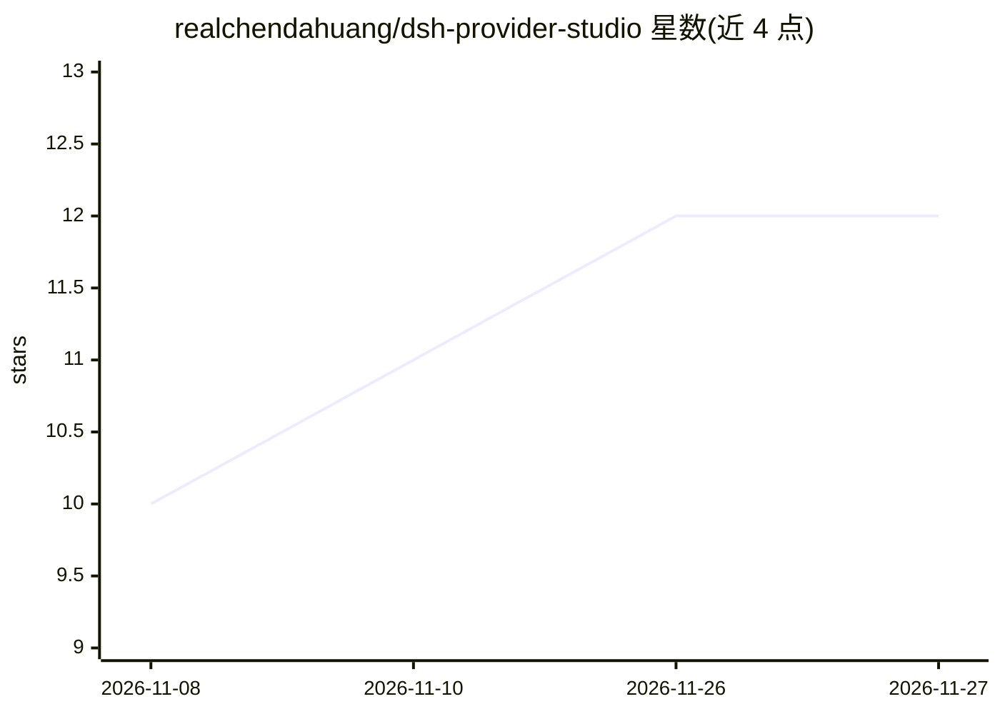

# realchendahuang/dsh-provider-studio

⭐ 12 · JavaScript · MIT · 推送 2026-11-08 · [GitHub](https://github.com/realchendahuang/dsh-provider-studio) · 个人维护 · 中文 README

**为 DSH 用户管理 LLM 供应商配置与 API 密钥的插件**

DeepSeek Harness（DSH）的供应商管理插件，替换内置 Models 设置页，直接读写 `llm-pi-ai` 补丁文档：掩码查看/替换/清除 API 密钥，编辑每模型 `reasoningEffort`、`compat` 与每供应商 headers、传输与重试等高级参数，提供连通性测试与端点模型批量发现，内置 218 个预填供应商模板，并可将单个供应商导出为可直接粘贴的 YAML。要求 DSH 0.2.2-rc.1 及以上，通过 CLI 或 GUI 安装，卸载后恢复官方页面。

## 筛选速览

| 维度 | 判定 | 备注 |
|---|---|---|
| AI 角色 | `ai-ecosystem` | LLM/agent 周边工具 |
| 许可风险 | `permissive` | MIT |
| 部署形态 | `None` |  |
| 模型依赖 | — | README 未给出锁定关系 |
| 硬件要求 | — | 无带数字的原话,不猜 |
| 安装摩擦 | `low` | 无编译、无系统依赖或容器化 |
| 成熟度 | — | 结构信号不足 |

## 能力要点

- 直接编辑 llm-pi-ai 原始补丁文档，避免 schema 丢失未声明字段
- 218 个供应商模板（来自 models.dev），201 个带品牌图标
- 连通性测试与模型发现使用与 DSH 会话相同的请求路径和自定义 headers
- 可按供应商导出仅含凭证名称的 YAML（不含密钥内容）

## 适用场景

- 批量查看与更换多个供应商的 API 密钥
- 发现某个端点支持的模型并批量接入 DSH
- 为自定义 headers、重试与传输参数做调试探针

## 场景标签

 · 领域:LLM 基础设施/配置管理

## 证据(README 行号)

> L5: A provider manager for DeepSeek Harness. It replaces the built-in **Models** settings page and edits the `llm-pi-ai`
> L30: Requires DSH 0.2.2-rc.1 or later on a `desktop` or `web` profile.

## 星数曲线

2026-11-08 10 → 2026-11-27 12（+2）

---
*卡片 v1 · prompt 1.4 · 生成 2026-11-19 · 置信度 high · 依据 README sha `62c2581a29af` · [字段定义](../../DATASET.md)*
