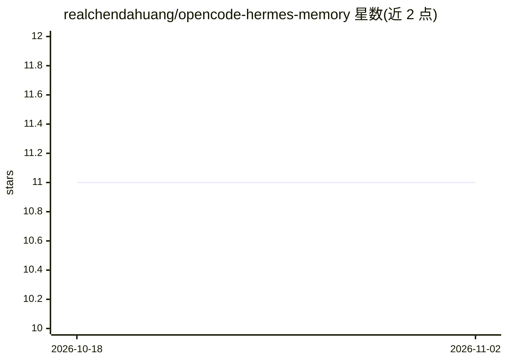

# realchendahuang/opencode-hermes-memory

⭐ 11 · TypeScript · MIT · 推送 2026-10-24 · [GitHub](https://github.com/realchendahuang/opencode-hermes-memory) · [官网](https://github.com/realchendahuang/opencode-hermes-memory#readme) · 个人维护

**为 OpenCode agent 提供纯 Markdown 分层持久记忆的插件**

从 Hermes 移植的 OpenCode 插件：以纯 Markdown 文件（无向量库、无外部服务）存储用户偏好、项目约定与失败教训，跨会话留存。分层设计含注入系统提示的 STANDING.md 硬规则、token 评分检索的 memory_search 工具、空闲时后台 LLM 复习归档、bash 命令失败时自动预取过往教训；被替换条目移入 history.md 保留演化轨迹。注册 5 个记忆工具，支持 opencode plugin 一键安装或手动克隆部署。

## 筛选速览

| 维度 | 判定 | 备注 |
|---|---|---|
| AI 角色 | `ai-ecosystem` | LLM/agent 周边工具 |
| 许可风险 | `permissive` | MIT |
| 部署形态 | `library` | 以包/库形式分发 |
| 模型依赖 | — | README 未给出锁定关系 |
| 硬件要求 | — | 无带数字的原话,不猜 |
| 安装摩擦 | `low` | 无编译、无系统依赖或容器化 |
| 成熟度 | — | 结构信号不足 |

## 能力要点

- L0-L2 分层记忆：STANDING.md 注入、Markdown 存储、无向量库的 token 评分检索
- 空闲后台 LLM 复习总结会话，规则式纠正检测即时保存
- 每条用户消息自动注入相关记忆（score ≥ 0.4，每轮最多 2 条）
- bash 失败时自动注入过往失败教训；被替换条目移入 history.md 可追溯

## 适用场景

- 让 OpenCode agent 在跨会话中记住我的偏好和项目约定
- 让 agent 从过去的命令失败中学习并避免重蹈覆辙
- 用 git 直接版本控制与手工编辑 agent 的记忆文件

## 场景标签

`Agent 记忆` · 领域:Agent 开发

## 证据(README 行号)

> L3: **Layered persistent memory for your OpenCode agent — ported from Hermes**
> L20: |**L2 — Retrieval**|`memory_search` tool with lightweight token-scored ranking (no vector DB needed)|

## 星数曲线

2026-10-18 11 → 2026-11-02 11（+0）

---
*卡片 v1 · prompt 1.4 · 生成 2026-11-01 · 置信度 mid · 依据 README sha `1e7e7686ee6d` · [字段定义](../../DATASET.md)*
