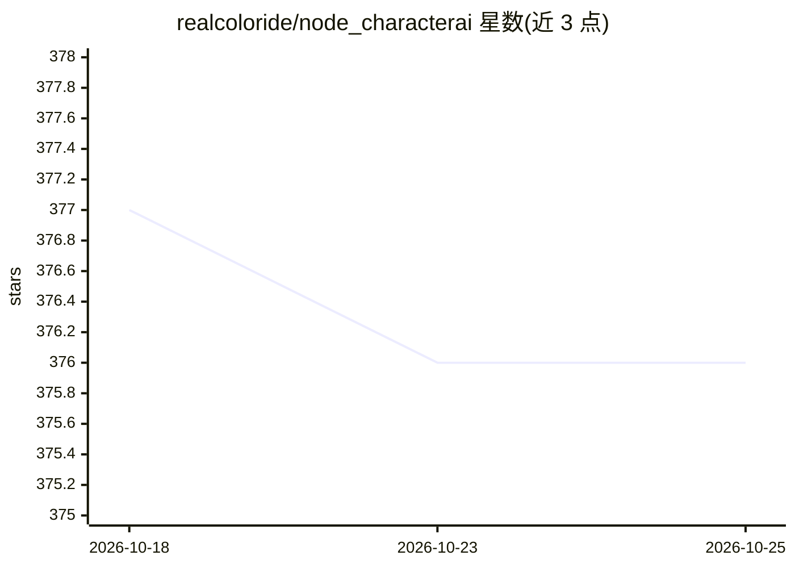

# realcoloride/node_characterai

⭐ 376 · JavaScript · 推送 2025-11-03 · [GitHub](https://github.com/realcoloride/node_characterai) · [官网](https://character.ai/) · 个人维护

**Character.AI 非官方 Node.js 客户端库（已宣布弃用）**

以 JavaScript/CommonJS 编写的 Node.js 库，封装 Character.AI 网站的非官方 API：支持访客与 sessionToken 登录、发起对话、获取角色信息，以及实验性的图片生成/上传功能。因 Cloudflare 反爬限制，1.1 版起改用 puppeteer 控制 Chromium 发起请求，Linux 下可能需手动指定 Chromium 路径。README 顶部声明当前版本已弃用，作者正转向 2.0 beta 版本。项目与 Character.AI 无官方隶属关系。

## 筛选速览

| 维度 | 判定 | 备注 |
|---|---|---|
| AI 角色 | `ai-ecosystem` | LLM/agent 周边工具 |
| 许可风险 | `none` | — |
| 部署形态 | `library` | 以包/库形式分发 |
| 模型依赖 | — | README 未给出锁定关系 |
| 硬件要求 | — | 无带数字的原话,不猜 |
| 安装摩擦 | `low` | 无编译、无系统依赖或容器化 |
| 成熟度 | — | 结构信号不足 |

## 能力要点

- 访客登录与 sessionToken 登录两种认证方式
- 对话消息、角色信息获取及实验性图片生成/上传
- 通过 puppeteer 控制 Chromium 绕过 Cloudflare 限制
- 支持 CharacterAI+ 会员属性设置（usePlus）

## 适用场景

- 在 Node.js 项目中接入 Character.AI 角色对话
- 为聊天机器人或多用户会话（conversations）分配角色
- 批量测试或构建基于 Character.AI 的应用

## 场景标签

 · 领域:LLM 应用/客户端库

## 证据(README 行号)

> L14: > Node.js client for the unofficial Character AI API, an awesome website which brings characters to life with AI!
> L38: npm install node_characterai

## 星数曲线

2026-10-18 377 → 2026-10-25 376（-1）

---
*卡片 v1 · prompt 1.4 · 生成 2026-10-21 · 置信度 high · 依据 README sha `6af52dfda9cb` · [字段定义](../../DATASET.md)*
