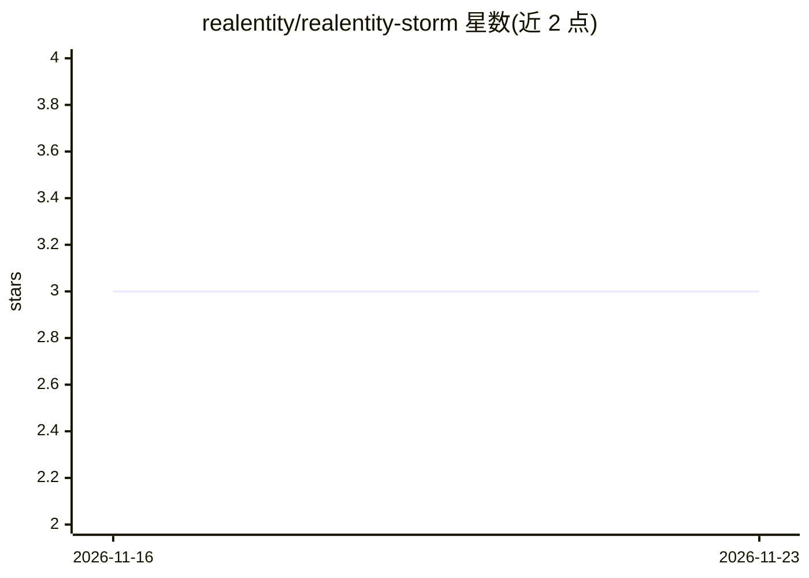

# realentity/realentity-storm

⭐ 3 · TypeScript · AGPL-3.0 · 推送 2026-11-22 · [GitHub](https://github.com/realentity/realentity-storm) · 组织维护

**自托管个人自动化 agent：对话描述需求，人工确认后执行**

运行在用户自己服务器上的单用户自动化 agent：用户通过聊天描述需求，系统将其编译为由 50 多种固定步骤类型组成的流水线（邮件、浏览器、HTTP/RSS、LLM、数据库、日历、Telegram、审批门等），LLM 只组合步骤、不能写代码。所有对外副作用（邮件、表单提交、上传、API 调用）都经审批门展示内容后需按下 Act 才发出。内置求职、账单、主题知识库等示例 App，通过用户编辑与拒绝记录学习规则，学习数据可查看与关闭。以 Docker 自托管方式运行于私有网络。

## 筛选速览

| 维度 | 判定 | 备注 |
|---|---|---|
| AI 角色 | `ai-native` | 本体是模型或模型工具 |
| 许可风险 | `viral` | AGPL-3.0 |
| 部署形态 | `library` | 以包/库形式分发 |
| 模型依赖 | locked-api |  |
| 硬件要求 | — | 无带数字的原话,不猜 |
| 安装摩擦 | `low` | 无编译、无系统依赖或容器化 |
| 成熟度 | — | 结构信号不足 |

## 能力要点

- 自然语言描述需求，编译为固定步骤目录（50+ 类型）组成的流水线，LLM 不写代码
- 所有对外副作用经审批门，用户查看内容并按下 Act 后才发出
- 浏览器配方（recipe）机制：版面变化时由浏览器 agent 提议修正并经用户批准
- 学习以可见数据形式保存：已批准文本作示例、编辑生成规则、夜间反思建议修改

## 适用场景

- 自动跟踪多个招聘板的职位并准备求职申请
- 从邮件和 PDF 中读取账单并在到期前提醒
- 基于主题事实库起草对招聘者或客户的回复
- 在无 API 的网站上用存储凭据读取页面或下载文件

## 场景标签

`浏览器自动化` `工作流自动化` `AI 助手` · 领域:效率与自动化

## 证据(README 行号)

> L5: **Your own automation agent, on your own server.** Tell Storm in a chat what you want taken care of: "keep my bills
> L12: Single user. Runs with Docker on a machine of yours, reached over your private network, not the Internet.
> L130: 2. **Storm compiles it** into a pipeline made only of steps from a fixed catalog of over 50 step types: mail, brow
> L141:  call) waits behind a gate that shows exactly what will go out. Edit it if needed, then press **Act** in the app o

## 星数曲线

2026-11-16 3 → 2026-11-23 3（+0）

---
*卡片 v1 · prompt 1.4 · 生成 2026-11-21 · 置信度 mid · 依据 README sha `2b44bdb4cd08` · [字段定义](../../DATASET.md)*
