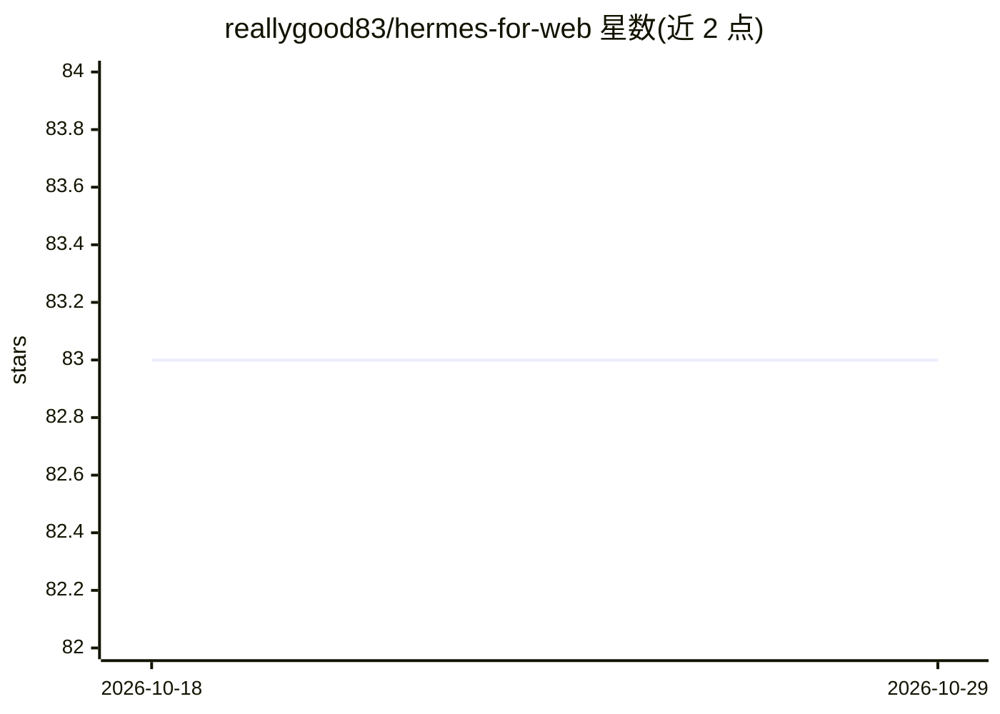

# reallygood83/hermes-for-web

⭐ 83 · Python · MIT · 推送 2026-04-06 · [GitHub](https://github.com/reallygood83/hermes-for-web) · [官网](https://www.youtube.com/@%EB%B0%B0%EC%9B%80%EC%9D%98%EB%8B%AC%EC%9D%B8-p5v) · 个人维护 · 中文 README

**Hermes Agent 的网页工作台：个性化界面、工作流与本地+远程模型**

Hermes WebUI 的 workflow 方向 fork，面向已使用 Hermes CLI 的个人用户，提供浏览器端的对话与模型编排界面（支持 Darwin 本地模型与 GPT 系列远程模型、会话级切换）。功能包括：读取 Hermes memory 的个性化启动页、Setup Packs 一键环境引导（Obsidian/ShareNote/Telegram 四种包）、artifact 生成与管理并接续 Share/Telegram/Memory 动作、执行前的 Preflight 轻量检查（note/posting/cron）。以韩语为主 UI，git clone 后经 start.sh 本地运行；Preflight 自称仍是轻量 MVP 版本，仓库准备先以 private 形式验证后再公开。

## 筛选速览

| 维度 | 判定 | 备注 |
|---|---|---|
| AI 角色 | `ai-ecosystem` | LLM/agent 周边工具 |
| 许可风险 | `permissive` | MIT |
| 部署形态 | `None` |  |
| 模型依赖 | — | README 未给出锁定关系 |
| 硬件要求 | — | 无带数字的原话,不猜 |
| 安装摩擦 | `low` | 无编译、无系统依赖或容器化 |
| 成熟度 | `idea` | |

## 能力要点

- 读取用户 Hermes memory 生成个性化启动页
- Setup Packs 一键引导 Obsidian/ShareNote/Telegram 等环境流程
- Artifact 创建/打开/删除并连接 Share/Telegram/Memory 动作
- 本地模型（Darwin）与 GPT 系列远程模型在会话级共存切换

## 适用场景

- 给已装的 Hermes CLI 配一个网页操作界面，与 Telegram/CLI 共用同一 AI
- 把对话产出转成 note/brief/memo 等文件并接入 Obsidian 或 Telegram 流程
- 执行定时任务或发帖前先跑一遍轻量检查

## 场景标签

`AI 助手` `工作流自动化` · 领域:效率与自动化

## 证据(README 行号)

> L11: Hermes for Web 은 Hermes Agent 를 위한 브라우저 작업실입니다.
> L205: 먼저 Hermes Agent 가 설치되어 있어야 합니다.
> L362: 이 저장소는 Hermes WebUI 기반의 workflow-focused fork 입니다.

## 星数曲线

2026-10-18 83 → 2026-10-29 83（+0）

---
*卡片 v1 · prompt 1.4 · 生成 2026-10-24 · 置信度 high · 依据 README sha `73e4e9177804` · [字段定义](../../DATASET.md)*
