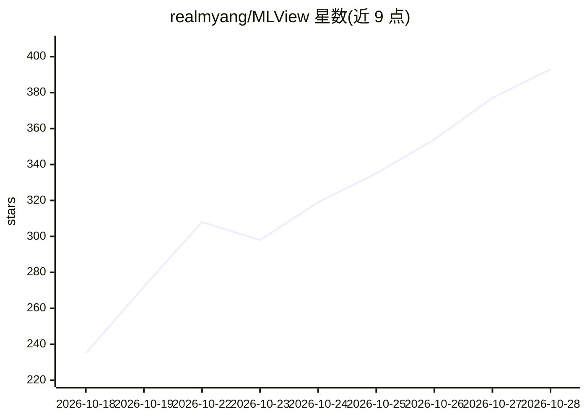

# realmyang/MLView

⭐ 414 · Python · MIT · 推送 2026-10-05 · [GitHub](https://github.com/realmyang/MLView) · [官网](https://github.com/realmyang/MLView#readme) · 个人维护

**让编码助手生成源码链接的 ML 工作流交互图的 VS Code 工具**

由三部分组成：面向 GitHub Copilot、Codex 和 Claude Code 的技能（skill）、统一的 WorkflowDocument 1.0 工件格式、以及 VS Code 查看器。用户在助手技能选择器中调用 mlview 提问，助手读取源码与配置，解释 ML 工作流并产出 *.mlview.json 图；查看器以交互图展示步骤、连接与发现（findings），每个声明附带带行号的源码引用，可点击跳转编辑器，支持逐条审查走查、修订对比、阶段总览与从代码反向定位到图。本地辅助程序仅校验引用与结构，不执行被分析程序；无需单独的模型 API key，模型由所选助手提供。README 自称实验性实现，语义解释的正确性未经人工审校确认。构建需 Python 3.10+ 与 Node 20.18.1+，从源码打包 VSIX 安装。

## 筛选速览

| 维度 | 判定 | 备注 |
|---|---|---|
| AI 角色 | `ai-ecosystem` | LLM/agent 周边工具 |
| 许可风险 | `permissive` | MIT |
| 部署形态 | `library` | 以包/库形式分发 |
| 模型依赖 | — | README 未给出锁定关系 |
| 硬件要求 | — | 无带数字的原话,不猜 |
| 安装摩擦 | `low` | 无编译、无系统依赖或容器化 |
| 成熟度 | `idea` | |

## 能力要点

- 为 Copilot / Codex / Claude Code 提供通用技能，产出统一 WorkflowDocument 1.0 格式图
- 图中每个步骤/连接/发现附带行号级源码引用，可打开到编辑器旁
- 逐条声明审查走查（Review），优先从推断与未观察项开始
- 修订按 id 对比新增/删除/变更项，源文件改动会标记受影响引用

## 适用场景

- 让 VS Code 里的编码助手解释训练工作流并生成可探索的图
- 逐条核验图中声明是否与所引源码行对应
- 向助手迭代提问以细化图的某个节点或发现

## 场景标签

 · 领域:开发者工具/机器学习可视化

## 证据(README 行号)

> L6: **Use the LLM in your existing VS Code assistant to understand an ML workflow,
> L8: for GitHub Copilot, Codex, and Claude Code, a common artifact format, and a
> L12: MLView requires no separate model API key. The selected assistant supplies the

## 星数曲线

2026-10-18 235 → 2026-10-28 393（+158）

---
*卡片 v1 · prompt 1.4 · 生成 2026-10-21 · 置信度 mid · 依据 README sha `920f17a48912` · [字段定义](../../DATASET.md)*
