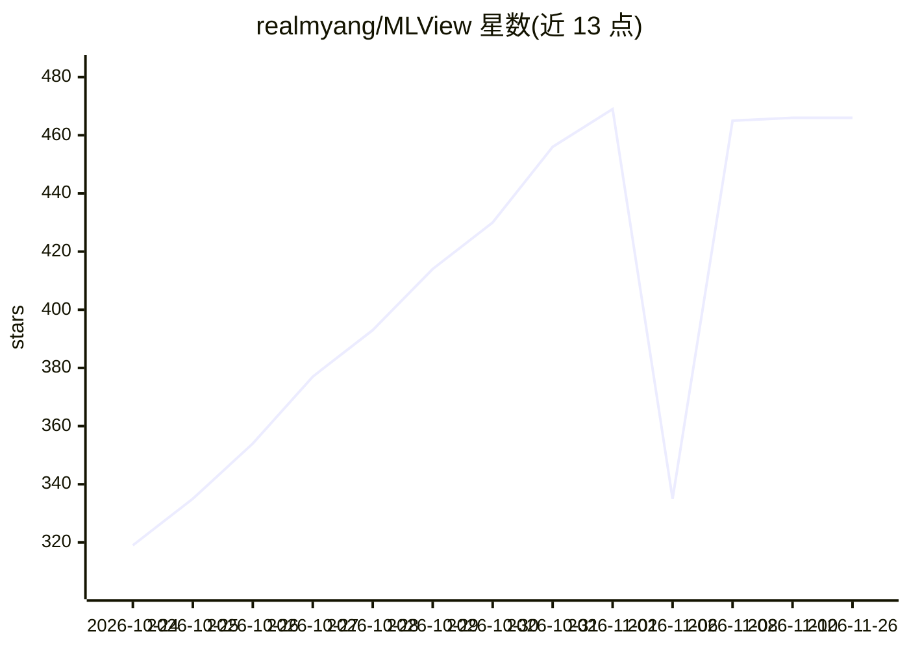

# realmyang/MLView

⭐ 466 · JavaScript · MIT · 推送 2026-10-30 · [GitHub](https://github.com/realmyang/MLView) · [官网](https://github.com/realmyang/MLView#readme) · 个人维护

**编程助手生成 ML 工作流交互图并在 VS Code 中查看的工具**

MLView 由三部分组成：面向 GitHub Copilot、Codex 和 Claude Code 的 agent 技能、一个 `.mlview.json` 文档格式、以及一个 VS Code 查看器扩展。编程助手读取代码与配置后写出包含步骤、连接、发现的图表，并附引用文件的原文引句；技能自带的辅助脚本检查文档结构、引用路径与引句一致性并记录文件哈希。查看与导航操作不调用模型。发布版以 `.vsix` 扩展与技能 ZIP 形式提供，也可从源码构建（需 Python 3.10+ 与 Node 20.18.1+）。README 声明格式与查看器在版本间仍可能变动。

## 筛选速览

| 维度 | 判定 | 备注 |
|---|---|---|
| AI 角色 | `ai-enhanced` | 去掉 AI 部分产品仍成立 |
| 许可风险 | `permissive` | MIT |
| 部署形态 | `library` | 以包/库形式分发 |
| 模型依赖 | — | README 未给出锁定关系 |
| 硬件要求 | — | 无带数字的原话,不猜 |
| 安装摩擦 | `low` | 无编译、无系统依赖或容器化 |
| 成熟度 | `idea` | |

## 能力要点

- skill + 文档格式 + VS Code 查看器三件套架构
- 辅助脚本检查结构、引用路径、引句并记录文件哈希
- 查看、过滤、导航图表不调用模型
- Claude Code 另提供插件打包形式

## 适用场景

- 让编程助手解读训练/蒸馏脚本并生成分步工作流图
- 点击图表步骤跳转到被引用的源码行核对 AI 结论
- 在 VS Code 中浏览示例 ML 项目的可交互说明图

## 场景标签

 · 领域:开发者工具/可视化

## 证据(README 行号)

> L7: answer as an interactive diagram linked to the source.** MLView is a skill for
> L8: GitHub Copilot, Codex and Claude Code, a document format, and a VS Code
> L28: - MLView needs no model API key of its own. Your assistant supplies the model,

## 星数曲线

2026-10-24 319 → 2026-11-26 466（+147）

---
*卡片 v1 · prompt 1.4 · 生成 2026-11-25 · 置信度 mid · 依据 README sha `639a0b748937` · [字段定义](../../DATASET.md)*
