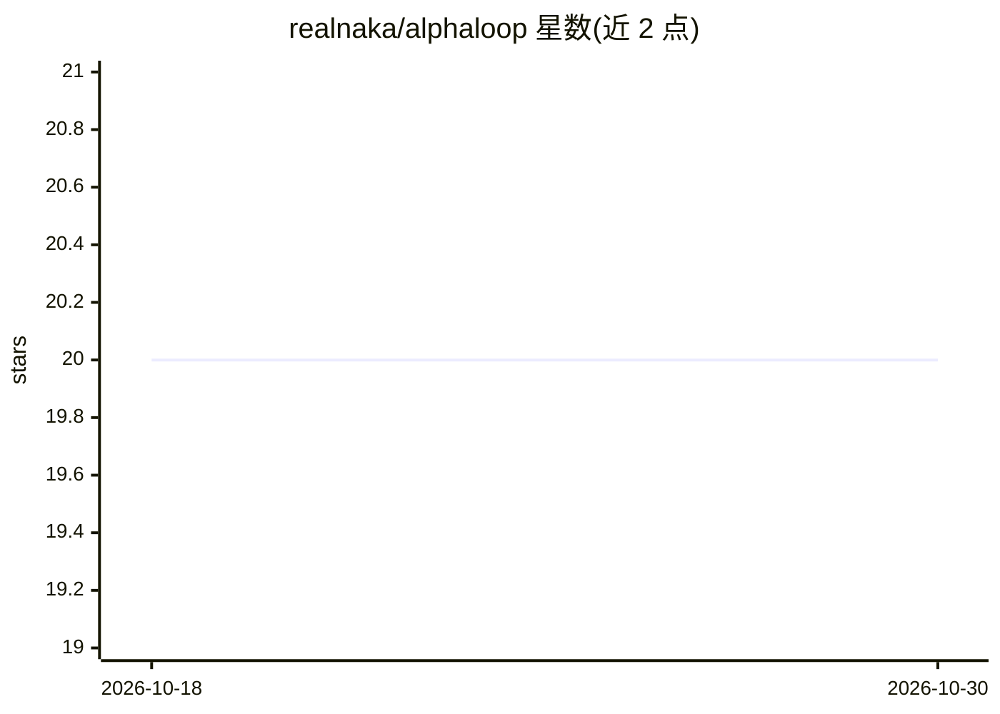

# realnaka/alphaloop

⭐ 20 · Shell · MIT · 推送 2026-06-23 · [GitHub](https://github.com/realnaka/alphaloop) · 个人维护 · 中文 README

**装进 AI 助手的人机投研技能套件：AI 查证取数，人做决策**

一套以 shell 脚本安装的投资研究协作流程技能包，适配 Claude Code、Cursor、Codex CLI 等支持 skills 的 AI 助手。核心为三步流程：人提出判断、AI 将其当作待验证假设逐条核实并拉取实时行情、人拍板决策；决策结果记录反馈形成闭环。配套能力含二手消息逐条溯源核查打标、覆盖 A股/港股/美股/加密货币/大宗商品的免密钥行情查询、本地自动保存的研究知识库（~/openorder/）、产业链分析框架与交易记账。仓库只含流程与空模板，不含数据，决策权归用户。

## 筛选速览

| 维度 | 判定 | 备注 |
|---|---|---|
| AI 角色 | `ai-ecosystem` | LLM/agent 周边工具 |
| 许可风险 | `permissive` | MIT |
| 部署形态 | `None` |  |
| 模型依赖 | — | README 未给出锁定关系 |
| 硬件要求 | — | 无带数字的原话,不猜 |
| 安装摩擦 | `low` | 无编译、无系统依赖或容器化 |
| 成熟度 | — | 结构信号不足 |

## 能力要点

- 三步人机分工流程：人出方向、AI 查证取数、人拍板
- 二手消息拆成声明逐条溯源核查并打标签
- 免密钥行情源覆盖 A股/港股/美股/加密货币/大宗商品，含盘中实时价
- 研究结论自动写入本地知识库并记时间线日志，跨对话复用

## 适用场景

- 让 AI 助手核实群聊转来的投资消息和研报截图
- 按固定流程做选股研究并自动沉淀研究成果
- 记录每笔交易的理由以便日后复盘归因

## 场景标签

`金融量化` `知识库管理` `科研工具` · 领域:知识与检索

## 证据(README 行号)

> L5: AlphaLoop 不是又一个"问答机器人"，而是一套**人机分工的工作流程**——它规定了在做投资研究时，**哪些事归你、哪些事归 AI、用什么顺序协作**。装上之后，你的 AI 助手（Claude、Cursor、Codex 等）
> L50: - **🔌 一次安装，多家 AI 通用**：支持 Claude Code、Cursor、Codex CLI 等主流 AI 助手，一个命令全装好。
> L88: 适用于支持 "skills"（AI 技能插件）的助手，如 Claude Code、Cursor、Codex CLI 等。

## 星数曲线

2026-10-18 20 → 2026-10-30 20（+0）

---
*卡片 v1 · prompt 1.4 · 生成 2026-10-28 · 置信度 mid · 依据 README sha `08b30b9c1a64` · [字段定义](../../DATASET.md)*
