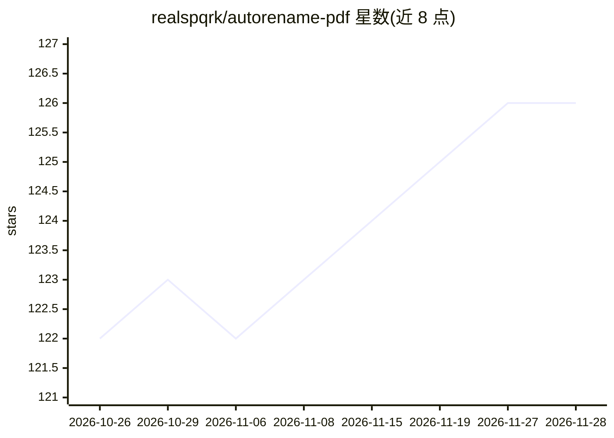

# realspqrk/autorename-pdf

⭐ 126 · Rust · MIT · 推送 2026-11-19 · [GitHub](https://github.com/realspqrk/autorename-pdf) · 个人维护

**用 AI 按内容自动重命名并归档 PDF 的桌面/命令行工具**

读取发票、信函、扫描件等 PDF，调用云端 AI（OpenAI、Anthropic、Gemini、xAI）或本地 Ollama 模型识别日期、公司、单据类型与金额，生成新文件名并将提取数据以 JSON 附件与元数据写回 PDF；支持撤销重命名、公司名一致性维护、本地 OCR 读取扫描件、business/academic 及自定义命名模板。提供窗口与命令行两种使用方式，支持代理工作流（plan/apply/undo、JSON 输出）。4.0 beta 版本不读取 3.x 设置；离线模式需安装 Ollama 并下载模型。

## 筛选速览

| 维度 | 判定 | 备注 |
|---|---|---|
| AI 角色 | `ai-native` | 本体是模型或模型工具 |
| 许可风险 | `permissive` | MIT |
| 部署形态 | `desktop` | 安装包/桌面程序 |
| 模型依赖 | local-ok | 支持本地模型 |
| 硬件要求 | — | 无带数字的原话,不猜 |
| 安装摩擦 | `medium` | 含编译或系统依赖之一 |
| 成熟度 | `idea` | |

## 能力要点

- 云端多 provider 或本地 Ollama 离线模式识别 PDF 内容
- 本地 OCR 读取扫描件，可禁止发送页面图像
- 提取数据嵌入 PDF JSON 附件与 XMP 元数据，可供脚本复用
- 命令行 plan/apply/undo 与 -o json 输出，面向 AI agent 设计

## 适用场景

- 批量把发票和扫描件按日期、公司、金额重命名归档
- 离线环境下用 Ollama 在本机处理敏感文档
- 让 AI agent 通过命令行自动整理 PDF 文件夹

## 场景标签

`文档解析` · 领域:知识与检索

## 证据(README 行号)

> L2:  Rename PDFs from their content with AI and local OCR.
> L10: Drop in invoices, letters and scans; get files named by date, company, document type and amount. AutoRename-PDF rea
> L118: ## For AI agents

## 星数曲线

2026-10-26 122 → 2026-11-28 126（+4）

---
*卡片 v1 · prompt 1.4 · 生成 2026-11-28 · 置信度 high · 依据 README sha `216c338a0b06` · [字段定义](../../DATASET.md)*
