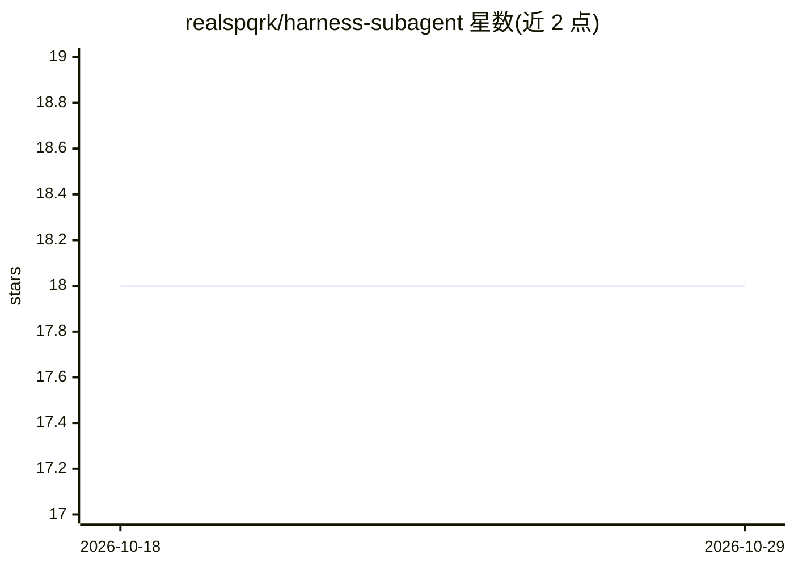

# realspqrk/harness-subagent

⭐ 18 · Shell · MIT · 推送 2026-10-27 · [GitHub](https://github.com/realspqrk/harness-subagent) · 个人维护

**把 Codex/Grok 等编码 agent CLI 作为一次性子代理调度的 Claude 技能**

Agent Skills 格式的技能：宿主 agent（如 Claude Code）写任务简报，通过 scripts/spawn.sh 在后台启动另一厂商的编码 agent CLI（Claude Code、Codex、Grok Build、Antigravity、Cursor CLI、Muse Code），读取其 report.md 并由父级判断采纳与否。支持指名 CLI/模型/effort，未指定时按任务表偏好不同厂商填充；不含 persona，子代理不再嵌套委派。要求至少一个目标 CLI 在 PATH 且已登录，需 Python 3，Windows 需 Git Bash。经 npx skills 或 git clone 安装。

## 筛选速览

| 维度 | 判定 | 备注 |
|---|---|---|
| AI 角色 | `ai-ecosystem` | LLM/agent 周边工具 |
| 许可风险 | `permissive` | MIT |
| 部署形态 | `library` | 以包/库形式分发 |
| 模型依赖 | locked-api |  |
| 硬件要求 | — | 无带数字的原话,不猜 |
| 安装摩擦 | `low` | 无编译、无系统依赖或容器化 |
| 成熟度 | — | 结构信号不足 |

## 能力要点

- 调度 6 种编码 agent CLI 作为子代理并裁决其报告
- 未指定时按任务表自动选择与父级不同厂商的模型
- scripts/health.sh 输出各 CLI 的版本/登录/更新状态
- 子代理遇 24 小时内重置的用量限额会等待并恢复同会话

## 适用场景

- 让另一厂商的模型对我写的代码做第二意见评审
- 把实现任务委托给其他 CLI 后由父 agent 审查差异
- 在 Superpowers 或 pstack 工作流中将评审步骤路由到外部模型

## 场景标签

`代码审查` · 领域:编码与开发

## 证据(README 行号)

> L17: That is this skill. You stay in the agent you already use. It becomes the parent: it writes a short brief, starts a
> L23: This is a Claude skill in the Agent Skills format. Any agent that can run a shell command in the background can use

## 星数曲线

2026-10-18 18 → 2026-10-29 18（+0）

---
*卡片 v1 · prompt 1.4 · 生成 2026-10-29 · 置信度 high · 依据 README sha `d47ce413ea26` · [字段定义](../../DATASET.md)*
