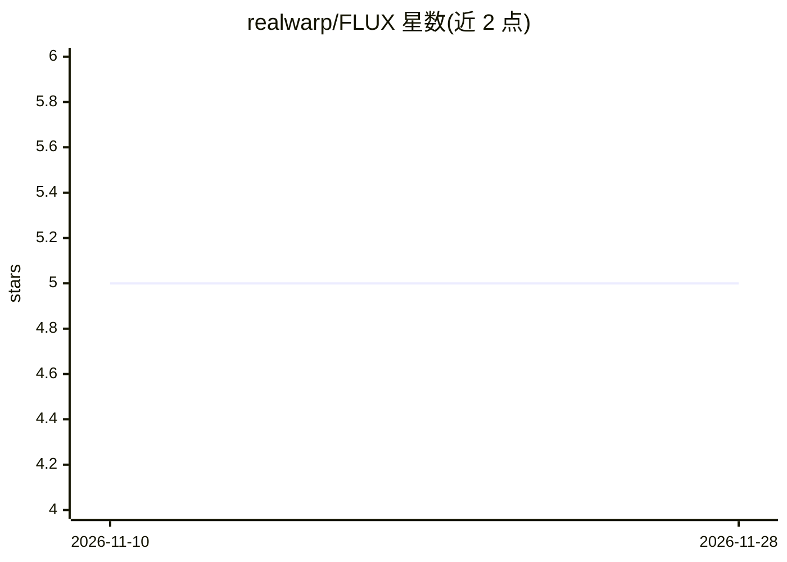

# realwarp/FLUX

⭐ 5 · TypeScript · MIT · 推送 2026-11-08 · [GitHub](https://github.com/realwarp/FLUX) · [官网](warpie.link/flux) · 个人维护

**终端 AI 编码助手：审批制地读改代码与执行命令**

运行在终端的编码助手，在选定工作区内读取与搜索文件、按审批应用写入与补丁、执行带边界的 shell 命令，并保存会话供恢复。首次运行引导选择 Ollama 或 OpenAI 兼容端点、选择模型并保存配置；密钥仅保存变量名不保存值。提供命令面板、模型选择器与 diff 视图。安装脚本校验 SHA-256，依赖 Bun 运行时；当前为 early access，发布资产尚未可用。

## 筛选速览

| 维度 | 判定 | 备注 |
|---|---|---|
| AI 角色 | `ai-native` | 本体是模型或模型工具 |
| 许可风险 | `permissive` | MIT |
| 部署形态 | `None` |  |
| 模型依赖 | local-ok | 支持本地模型 |
| 硬件要求 | — | 无带数字的原话,不猜 |
| 安装摩擦 | `low` | 无编译、无系统依赖或容器化 |
| 成熟度 | `idea` | |

## 能力要点

- 文件写入、补丁与 shell 命令默认需交互审批，支持 --approve 自动批准
- 支持 Ollama 与 OpenAI 兼容端点，配置时测试连接并保存模型选择
- 会话本地保存并可恢复先前对话
- 安装器校验发布包 SHA-256 并按平台矩阵下载

## 适用场景

- 在终端里让 AI 模型探索并修改本地项目代码
- 对 AI 的文件改动和命令执行做逐项审批控制
- 用本地 Ollama 模型离线进行代码修复

## 场景标签

`编码 Agent` · 领域:编码与开发

## 证据(README 行号)

> L5: A terminal coding assistant for exploring and changing a project with an AI model you choose.
> L33: - Reads and searches files inside the selected workspace.
> L37: - Supports Ollama and OpenAI-compatible providers.

## 星数曲线

2026-11-10 5 → 2026-11-28 5（+0）

---
*卡片 v1 · prompt 1.4 · 生成 2026-11-21 · 置信度 high · 依据 README sha `e386c996e8f8` · [字段定义](../../DATASET.md)*
