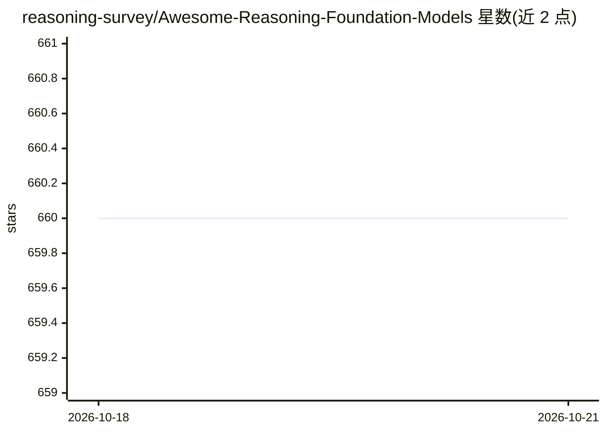

# reasoning-survey/Awesome-Reasoning-Foundation-Models

⭐ 660 · MIT · 推送 2026-09-03 · [GitHub](https://github.com/reasoning-survey/Awesome-Reasoning-Foundation-Models) · 组织维护

**推理基础模型论文与基准的策展清单（配综述论文）**

基于综述论文《A Survey of Reasoning with Foundation Models》维护的论文清单：按语言、视觉、多模态基础模型三大类组织条目，每条给出时间、论文、代码与项目链接；另覆盖常识、数学、逻辑、因果、视觉、音频、agent 推理等推理任务与预训练、微调、对齐、MoE、上下文学习等技术方向的文献，并收录相关综述链接。条目按时间倒序排列，通过 PR 接受社区贡献。面向科研人员做文献检索与调研使用，不含可运行代码。

## 筛选速览

| 维度 | 判定 | 备注 |
|---|---|---|
| AI 角色 | `ai-knowledge` | 知识聚合/清单类 |
| 许可风险 | `permissive` | MIT |
| 部署形态 | `None` |  |
| 模型依赖 | — | README 未给出锁定关系 |
| 硬件要求 | — | 无带数字的原话,不猜 |
| 安装摩擦 | `low` | 无编译、无系统依赖或容器化 |
| 成熟度 | — | 结构信号不足 |

## 能力要点

- 语言/视觉/多模态三类基础模型论文分类组织
- 覆盖常识、数学、逻辑、因果、agent 等推理任务的论文与基准
- 基于团队发表的综述论文构建并持续更新
- 收录多篇相关领域的其他综述链接

## 适用场景

- 调研基础模型推理方向的论文与代码
- 查找特定推理任务（如常识问答、数学推理）的相关工作
- 跟踪语言、视觉、多模态基础模型的发展脉络

## 场景标签

`科研工具` `精选清单` · 领域:学习与行业

## 证据(README 行号)

> L9: A curated list of awesome **large AI models**, or **foundation models**, for **reasoning**.
> L11: We organize the current foundation models into three categories: *language foundation models*, *vision foundation m

## 星数曲线

2026-10-18 660 → 2026-10-21 660（+0）

---
*卡片 v1 · prompt 1.4 · 生成 2026-10-22 · 置信度 high · 依据 README sha `771f1ea4dc64` · [字段定义](../../DATASET.md)*
