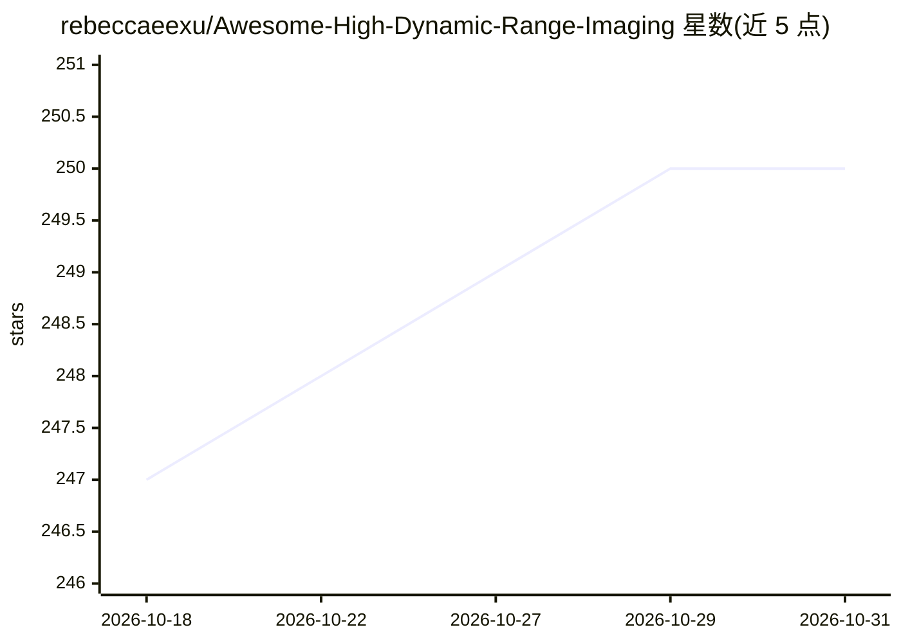

# rebeccaeexu/Awesome-High-Dynamic-Range-Imaging

⭐ 250 · MIT · 推送 2026-08-08 · [GitHub](https://github.com/rebeccaeexu/Awesome-High-Dynamic-Range-Imaging) · 个人维护

**高动态范围成像（HDR）论文清单：多帧/单帧/视频/色调映射等分类**

个人维护的 HDR 成像领域论文汇编仓库，按 Multi-Frame、Single-Frame、HDRTV、HDR Video、Tone Mapping、Traditional HDRI 等章节组织，条目以表格列出标题、发表会议/期刊、代码与数据集链接及关键词，时间跨度从 2012 年至 2026 年，另收录 NTIRE 挑战赛论文与 HDR 数据集信息（含规模、分辨率、采集方式）。仓库声明持续更新，接受 issue 推荐新论文。仅提供论文索引，不包含可运行的代码或安装步骤。

## 筛选速览

| 维度 | 判定 | 备注 |
|---|---|---|
| AI 角色 | `ai-knowledge` | 知识聚合/清单类 |
| 许可风险 | `permissive` | MIT |
| 部署形态 | `None` |  |
| 模型依赖 | — | README 未给出锁定关系 |
| 硬件要求 | — | 无带数字的原话,不猜 |
| 安装摩擦 | `low` | 无编译、无系统依赖或容器化 |
| 成熟度 | — | 结构信号不足 |

## 能力要点

- 按 7 个技术方向组织的 HDR 论文表格（标题/出处/代码/数据集/关键词）
- 收录 NTIRE 2021/2022 HDR 挑战赛论文条目
- 单列 HDR 数据集章节，标注样本量、分辨率与真值情况

## 适用场景

- 查找 HDR 重建与去鬼影方向的论文及配套开源代码
- 比较可用 HDR 数据集的规模与采集方式
- 追踪 2012 年以来 HDR 成像研究的时间脉络

## 场景标签

`精选清单` · 领域:学习与行业

## 证据(README 行号)

> L1: # Paper List | High Dynamic Range Imaging
> L3: This repository compiles a list of papers related to HDR. (Updating)
> L9: ## HDR Papers

## 星数曲线

2026-10-18 247 → 2026-10-31 250（+3）

---
*卡片 v1 · prompt 1.4 · 生成 2026-10-30 · 置信度 high · 依据 README sha `d0a610694a09` · [字段定义](../../DATASET.md)*
