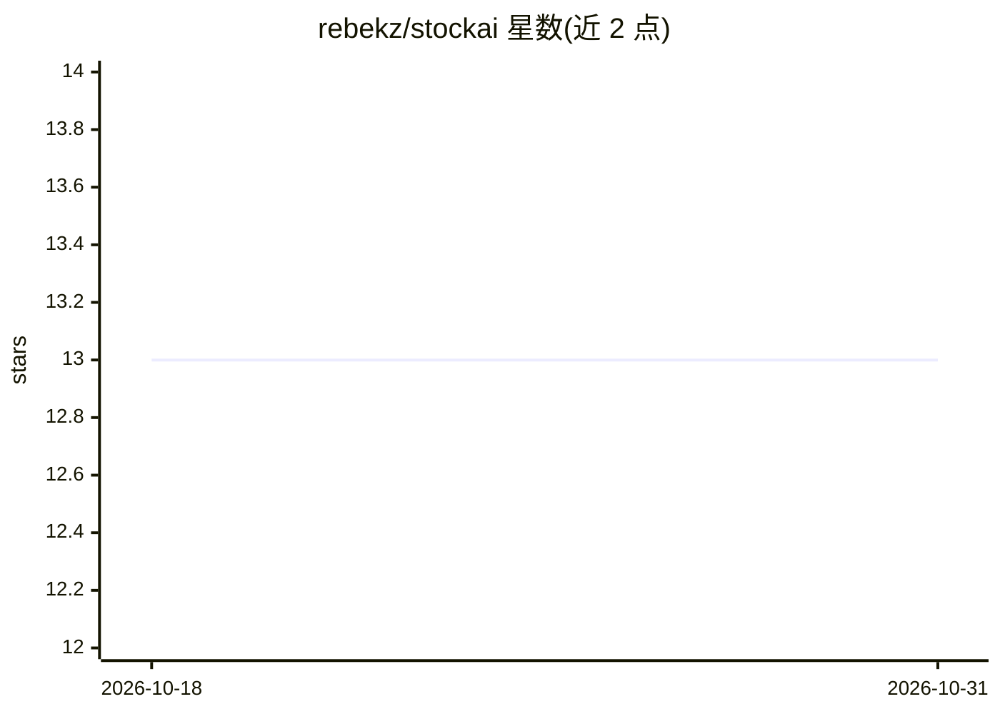

# rebekz/stockai

⭐ 13 · Python · 推送 2026-01-25 · [GitHub](https://github.com/rebekz/stockai) · 个人维护

**印尼股票（IDX）AI 分析 CLI：多 agent 交易与风控，面向被动投资者**

面向印尼股市散户的 Python 命令行工具，为每天 15 分钟、小资金（<Rp 1000 万）的被动投资者设计。提供 7 个专业 AI agent 组成的多 agent 交易系统、6 道质量闸门决策过滤、多因子评分（价值 25%/质量 30%/动量 25%/波动 20%）、仓位与分散化风控、组合风险指标（VaR/Sharpe/回撤），以及早盘/收盘简报、模拟交易和 8 节教程。新闻情绪分析使用 Gemini，需配置 GOOGLE_API_KEY；通过 git clone 源码加 uv 运行，README 声明仅供教育研究用途。

## 筛选速览

| 维度 | 判定 | 备注 |
|---|---|---|
| AI 角色 | `ai-native` | 本体是模型或模型工具 |
| 许可风险 | `none` | — |
| 部署形态 | `None` |  |
| 模型依赖 | — | README 未给出锁定关系 |
| 硬件要求 | — | 无带数字的原话,不猜 |
| 安装摩擦 | `low` | 无编译、无系统依赖或容器化 |
| 成熟度 | — | 结构信号不足 |

## 能力要点

- 7 个专业 AI agent 的多 agent 交易系统与 3-agent 交叉验证
- 6-Gate 决策过滤与自动交易计划生成（入场区间/止损/止盈）
- 多因子评分与组合风险指标（VaR、Sharpe、beta、最大回撤）
- 模拟交易（paper trading）与 8 节印尼股市教程

## 适用场景

- 每天用 15 分钟做印尼股票的早盘检查与收盘复盘
- 买入前对个股跑 6 道闸门的质量分析与交易计划
- 用虚拟资金练习交易并学习印尼股市基础

## 场景标签

`多智能体` `金融量化` `教程课程` · 领域:Agent 开发

## 证据(README 行号)

> L20: - **Multi-Agent Trading System** - 7 specialized AI agents (Analyst, Researcher, Risk Manager, etc.)
> L22: - **Sentiment Analysis** - Gemini-powered Indonesian news analysis

## 星数曲线

2026-10-18 13 → 2026-10-31 13（+0）

---
*卡片 v1 · prompt 1.4 · 生成 2026-10-31 · 置信度 high · 依据 README sha `100c0af8ac5f` · [字段定义](../../DATASET.md)*
