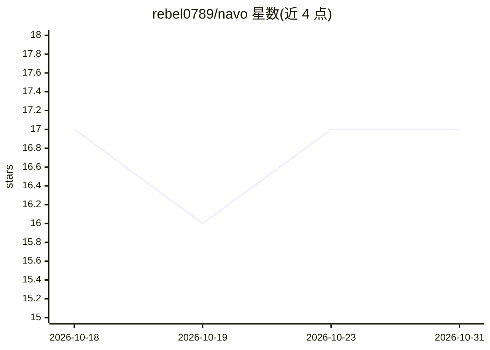

# rebel0789/navo

⭐ 17 · JavaScript · MIT · 推送 2026-06-13 · [GitHub](https://github.com/rebel0789/navo) · [官网](https://www.npmjs.com/package/@rebel0x/navo) · 个人维护

**让 Codex 接入 OpenCode Go 模型的本地桥接与路由工具**

Navo 是运行在本地的 Codex App/CLI 桥接器：在 127.0.0.1 起一个 Responses API 适配器，把 Codex 的请求转发到 OpenCode Go 的 OpenAI/Anthropic 兼容端点，可在 Codex 原生模式与 OpenCode 模式间切换。支持 GLM、Kimi、DeepSeek、MiMo（Chat Completions）与 MiniMax、Qwen（Messages）路由，并记录不含提示词、请求头与密钥的路由证明日志。提供 npx/npm 安装的 CLI 与控制台。限制：需 macOS（Codex App 控制、Keychain）、Node.js 20+ 与 OpenCode Go API key。

## 筛选速览

| 维度 | 判定 | 备注 |
|---|---|---|
| AI 角色 | `ai-ecosystem` | LLM/agent 周边工具 |
| 许可风险 | `permissive` | MIT |
| 部署形态 | `library` | 以包/库形式分发 |
| 模型依赖 | — | README 未给出锁定关系 |
| 硬件要求 | — | 无带数字的原话,不猜 |
| 安装摩擦 | `low` | 无编译、无系统依赖或容器化 |
| 成熟度 | — | 结构信号不足 |

## 能力要点

- 本地 Responses API 适配器转发请求到 OpenCode Go 端点
- 路由证明日志不含提示词、请求头与 API key
- 修改 ~/.codex/config.toml 前自动写入备份
- CLI 提供 probe-routing / verify / logs 等核验命令

## 适用场景

- 在 Codex 里切换使用 OpenCode Go 提供的模型
- 核验 Codex 请求实际路由到了哪个上游
- 在不泄露提示内容与密钥的前提下保留本地路由记录

## 场景标签

`模型网关` · 领域:Agent 开发

## 证据(README 行号)

> L9: Navo is a local bridge for Codex App and Codex CLI. It configures Codex to call a local Responses API adapter on `12
> L44: - Runs a local Responses API adapter at `http://127.0.0.1:17853/v1`.
> L111: OpenCode Go exposes documented OpenAI-compatible and Anthropic-compatible endpoints. Navo sits between them:

## 星数曲线

2026-10-18 17 → 2026-10-31 17（+0）

---
*卡片 v1 · prompt 1.4 · 生成 2026-10-29 · 置信度 high · 依据 README sha `b3d669ea5ff3` · [字段定义](../../DATASET.md)*
