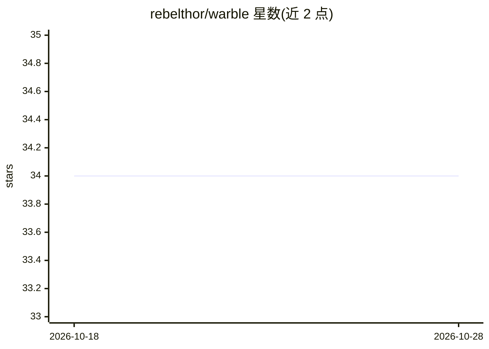

# rebelthor/warble

⭐ 34 · Go · MIT · 推送 2026-06-16 · [GitHub](https://github.com/rebelthor/warble) · 个人维护 · 中文 README

**M5Stack StackChan 机器人的全本地 AI 语音后端**

替代 xiaozhi.me 云服务的本地后端：在用户自己的 Linux/macOS 机器上实现 StackChan 固件（xiaozhi-esp32）的 WebSocket 协议，完成听—转录—回复—播报的完整语音对话闭环。由 whisper.cpp 转录、Silero VAD 检测说话结束、Ollama 生成回复、Piper 朗读，并根据回复中的情绪标签驱动机器人表情。以 bash 脚本加 Docker 编排交付，一条 ./warble start 完成部署；需要 Docker 与模型磁盘空间，Windows 不支持，配置分为 live 与 startup 两层，支持更换语言与模型。

## 筛选速览

| 维度 | 判定 | 备注 |
|---|---|---|
| AI 角色 | `ai-ecosystem` | LLM/agent 周边工具 |
| 许可风险 | `permissive` | MIT |
| 部署形态 | `self-host` | docker 或自建部署 |
| 模型依赖 | local-ok | 支持本地模型 |
| 硬件要求 | — | 无带数字的原话,不猜 |
| 安装摩擦 | `low` | 无编译、无系统依赖或容器化 |
| 成熟度 | `idea` | |

## 能力要点

- 本地实现 xiaozhi-esp32 的 WebSocket 协议，设备端无需改动
- whisper.cpp + Silero VAD + Ollama + Piper 全本地语音对话管线
- 回复携带情绪标签（7 种）驱动机器人表情
- 一条 ./warble start 完成 Docker 检查、拉模型、构建与启动

## 适用场景

- 让 StackChan 桌面机器人在无云账户、无 API key 的情况下对话
- 把机器人的语音数据留在本地网络内
- 通过编辑 prompt.txt 和更换模型自定义机器人性格与语言

## 场景标签

`语音 Agent` · 领域:对话与助手

## 证据(README 行号)

> L12: The stock StackChan firmware (the `xiaozhi-esp32` AI agent) connects to a cloud
> L25: The server runs the whole turn locally: whisper.cpp transcribes what you say,
> L26: Silero VAD detects when you stop, Ollama generates the reply, and Piper speaks it.

## 星数曲线

2026-10-18 34 → 2026-10-28 34（+0）

---
*卡片 v1 · prompt 1.4 · 生成 2026-10-25 · 置信度 mid · 依据 README sha `0c9a2bca700a` · [字段定义](../../DATASET.md)*
