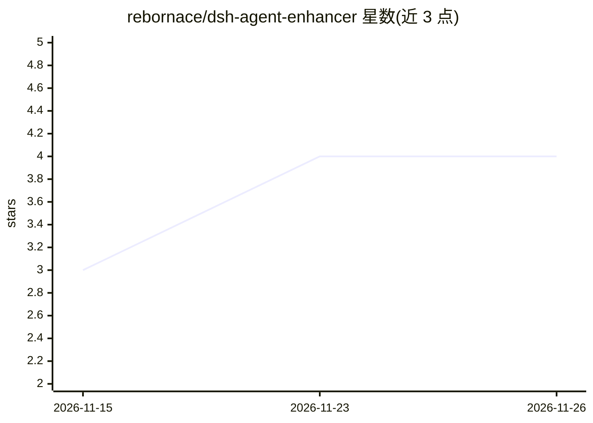

# rebornace/dsh-agent-enhancer

⭐ 4 · TypeScript · MIT · 推送 2026-11-25 · [GitHub](https://github.com/rebornace/dsh-agent-enhancer) · 个人维护 · 中文 README

**DeepSeek Harness Desktop 的智能体增强插件**

以 DSH 官方插件形式安装，为 DeepSeek Harness Desktop 的 Agent 会话补充能力：提示词输入历史与优化、暂停后续模型调用、运行通知、检查点恢复、工作区文件编辑与技能/连接器管理、Token 用量与上下文占用统计、Auto 模型路由、网页聊天导入、浏览器控制等 15 个开关，均默认开启且可在设置中逐项关闭。安装支持应用内插件市场或 dsh CLI，兼容 DSH >=0.2.2-rc.2 <0.3.0-0，声明无遥测上传。

## 筛选速览

| 维度 | 判定 | 备注 |
|---|---|---|
| AI 角色 | `ai-enhanced` | 去掉 AI 部分产品仍成立 |
| 许可风险 | `permissive` | MIT |
| 部署形态 | `library` | 以包/库形式分发 |
| 模型依赖 | locked-api |  |
| 硬件要求 | — | 无带数字的原话,不猜 |
| 安装摩擦 | `low` | 无编译、无系统依赖或容器化 |
| 成熟度 | — | 结构信号不足 |

## 能力要点

- 检查点恢复：气泡或时间线恢复对话，含撤销恢复
- 暂停后续：拦截下一轮模型调用以节省 token
- 浏览器控制：专用窗口、演示录制与流程保存重放
- Token 用量、余额与上下文占用明细及一键压缩

## 适用场景

- 为 DSH 桌面端补充提示词优化与输入历史
- 追踪每次会话的 token 消耗与上下文占用
- 在对话出错或完成后获得系统通知
- 用浏览器控制让智能体操作网页并录制流程

## 场景标签

`提示工程` · 领域:Agent 开发

## 证据(README 行号)

> L5: > 让 DeepSeek Harness Desktop **更好写、更好改、更好回退、更看得见用量与上下文**。
> L6: > 能力嵌在官方会话与设置里，默认开启，可在 **设置 → 内置插件 → 智能体增强** 逐项关闭。
> L41: |**应用内（推荐）**|**设置 → 插件** 搜索 `dsh-agent-enhancer` / **智能体增强** → 安装 → 重启|

## 星数曲线

2026-11-15 3 → 2026-11-26 4（+1）

---
*卡片 v1 · prompt 1.4 · 生成 2026-11-21 · 置信度 high · 依据 README sha `c8c7e23ffa41` · [字段定义](../../DATASET.md)*
