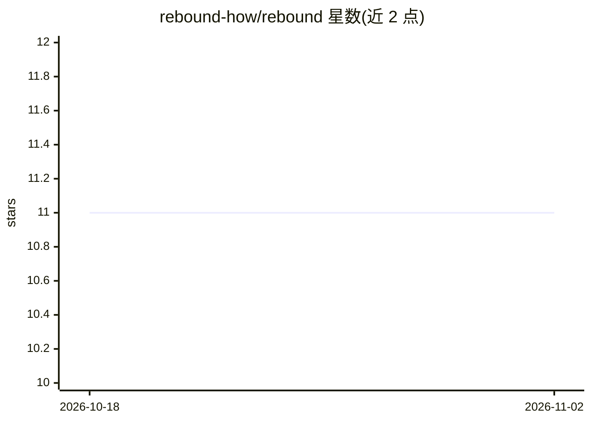

# rebound-how/rebound

⭐ 11 · Python · Apache-2.0 · 推送 2026-05-05 · [GitHub](https://github.com/rebound-how/rebound) · [官网](https://rebound.how) · 组织维护

**面向韧性运营的开源工具箱：故障注入、混沌工程与可靠性平台**

Rebound 是一个由三个应用组成的开源韧性运营工具箱：fault（Rust 编写的 CLI 与 AI MCP 服务器，可在本机模拟网络中断）、Chaos Toolkit（Python CLI，附带混沌工程生态，用于评估对运维事件的响应）以及 Reliably（集中编排可靠性策略的完整平台）。面向构建和推进韧性策略的 SRE/DevOps 从业者。README 未提供具体安装命令，仅指向外部文档；同时声明提供商业支持。

## 筛选速览

| 维度 | 判定 | 备注 |
|---|---|---|
| AI 角色 | `ai-ecosystem` | LLM/agent 周边工具 |
| 许可风险 | `permissive` | Apache-2.0 |
| 部署形态 | `None` |  |
| 模型依赖 | — | README 未给出锁定关系 |
| 硬件要求 | — | 无带数字的原话,不猜 |
| 安装摩擦 | `low` | 无编译、无系统依赖或容器化 |
| 成熟度 | — | 结构信号不足 |

## 能力要点

- fault：Rust 实现的 CLI 与 AI MCP 服务器，本机模拟网络中断
- Chaos Toolkit：Python CLI，混沌工程生态评估事件响应
- Reliably：集中化编排可靠性策略的平台

## 适用场景

- 在本机模拟网络故障以演练系统韧性
- 用混沌工程实验评估团队对运维事件的响应
- 集中管理组织的可靠性策略

## 场景标签

 · 领域:运维/可靠性工程

## 证据(README 行号)

> L11: * fault: a Rust-powered CLI & AI MCP server that simulates network disruptions right from your machine.
> L12: * Chaos Toolkit: a Python CLI with a rich Chaos Engineering ecosystem to evaluate your response to operational inci
> L13: * Reliably: a full platform to centralize and orchestrate your reliability strategy.

## 星数曲线

2026-10-18 11 → 2026-11-02 11（+0）

---
*卡片 v1 · prompt 1.4 · 生成 2026-11-01 · 置信度 mid · 依据 README sha `e4c441e96183` · [字段定义](../../DATASET.md)*
