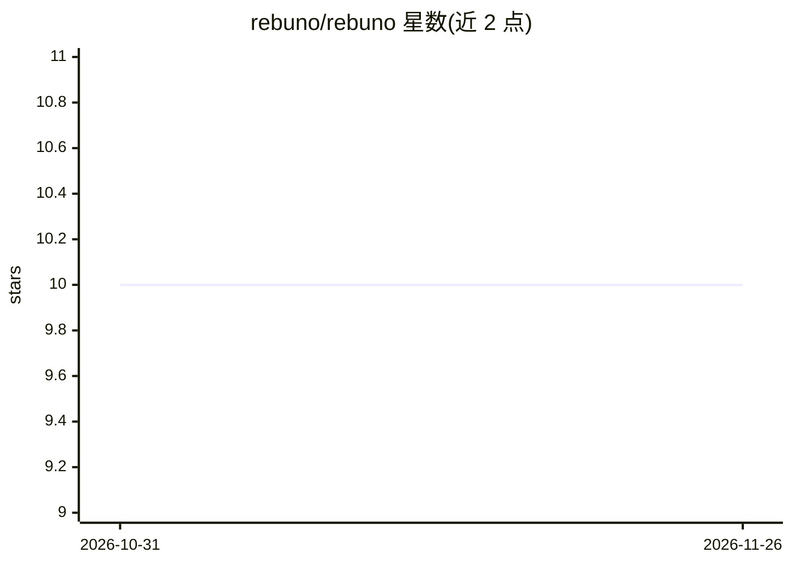

# rebuno/rebuno

⭐ 10 · Go · MIT · 推送 2026-11-23 · [GitHub](https://github.com/rebuno/rebuno) · [官网](https://rebuno.io) · 个人维护

**给生产级 AI agent 的持久化执行运行时与护栏**

Rebuno 是面向生产 agent 的开源执行运行时：把每次工具调用和 LLM 调用记录为持久化步骤，中断的运行从最近记录的步骤恢复而非从头重来；每一步可被允许、拒绝或挂起等待人工审批。以内核加 CLI 形式运行，提供 Python 与 TypeScript SDK、HTTP API、YAML 规则语言（allow/deny/require-approval）以及查看执行、步骤与事件的 Web Dashboard。要求 Go 1.26+、Python 3.11+ 或 Node 22+，MIT 许可。

## 筛选速览

| 维度 | 判定 | 备注 |
|---|---|---|
| AI 角色 | `ai-ecosystem` | LLM/agent 周边工具 |
| 许可风险 | `permissive` | MIT |
| 部署形态 | `library` | 以包/库形式分发 |
| 模型依赖 | — | README 未给出锁定关系 |
| 硬件要求 | — | 无带数字的原话,不猜 |
| 安装摩擦 | `low` | 无编译、无系统依赖或容器化 |
| 成熟度 | — | 结构信号不足 |

## 能力要点

- 工具调用与 LLM 调用记录为持久化步骤，中断后可从上一步恢复
- 逐步护栏策略：allow / deny / require-approval（YAML 规则）
- 提供 Python 与 TypeScript SDK、HTTP API 与 CLI
- Web Dashboard 查看执行、步骤、事件与 agent 活动

## 适用场景

- 生产环境中运行可中断恢复的后台 agent
- 对 agent 的工具调用与 LLM 调用做人工审批控制
- 追踪和回放 agent 执行的事件日志

## 场景标签

`Agent 框架` · 领域:Agent 开发

## 证据(README 行号)

> L7: Rebuno is an open-source execution runtime for production agents.
> L9: It records every tool call and LLM call as a durable step. Interrupted runs resume from the last recorded step inste
> L63: - Policy: the YAML rule language for allow / deny / require-approval.

## 星数曲线

2026-10-31 10 → 2026-11-26 10（+0）

---
*卡片 v1 · prompt 1.4 · 生成 2026-11-19 · 置信度 high · 依据 README sha `844c969f608e` · [字段定义](../../DATASET.md)*
