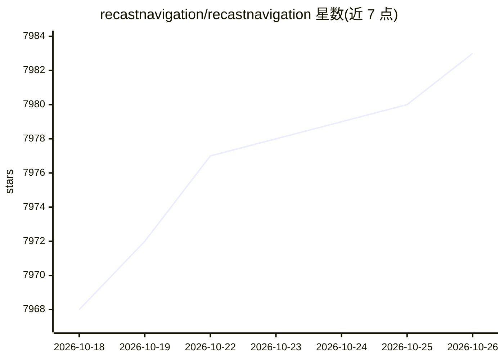

# recastnavigation/recastnavigation

⭐ 7,983 · C++ · Zlib · 推送 2026-02-27 · [GitHub](https://github.com/recastnavigation/recastnavigation) · [官网](http://recastnav.com/) · 组织维护

**游戏用导航网格生成与寻路工具集**

面向游戏开发的 C++ 导航网格（navmesh）工具集，分模块提供：Recast 从任意关卡几何生成导航网格，Detour 提供网格加载、寻路与查询，DetourTileCache 支持大世界的网格流式加载，DetourCrowd 提供角色移动、碰撞回避与群体模拟。构建仅需符合 C++98 的编译器，无外部依赖；README 称其被 Unity、Unreal、Godot、O3DE 等引擎采用。提供独立演示程序 RecastDemo 与单元测试，采用 ZLib 许可证。

## 筛选速览

| 维度 | 判定 | 备注 |
|---|---|---|
| AI 角色 | `ai-ecosystem` | LLM/agent 周边工具 |
| 许可风险 | `viral` | Zlib |
| 部署形态 | `None` |  |
| 模型依赖 | — | README 未给出锁定关系 |
| 硬件要求 | — | 无带数字的原话,不猜 |
| 安装摩擦 | `low` | 无编译、无系统依赖或容器化 |
| 成熟度 | — | 结构信号不足 |

## 能力要点

- Recast 从任意关卡几何体素化自动生成 navmesh
- Detour 提供寻路、navmesh 查询与流式加载
- DetourCrowd 支持角色移动、碰撞回避与群体模拟
- 无外部依赖，仅需 C++98 编译器

## 适用场景

- 为游戏关卡自动生成导航网格
- 实现角色寻路与群体移动模拟
- 大世界/开放世界场景的 navmesh 流式加载

## 场景标签

 · 领域:游戏开发/导航寻路

## 证据(README 行号)

> L16: - `Recast/` - Navmesh generation
> L17: - `Detour/` - Runtime loading of navmesh data, pathfinding, navmesh queries

## 星数曲线

2026-10-18 7,968 → 2026-10-26 7,983（+15）

---
*卡片 v1 · prompt 1.4 · 生成 2026-10-20 · 置信度 high · 依据 README sha `a74055dd0673` · [字段定义](../../DATASET.md)*
