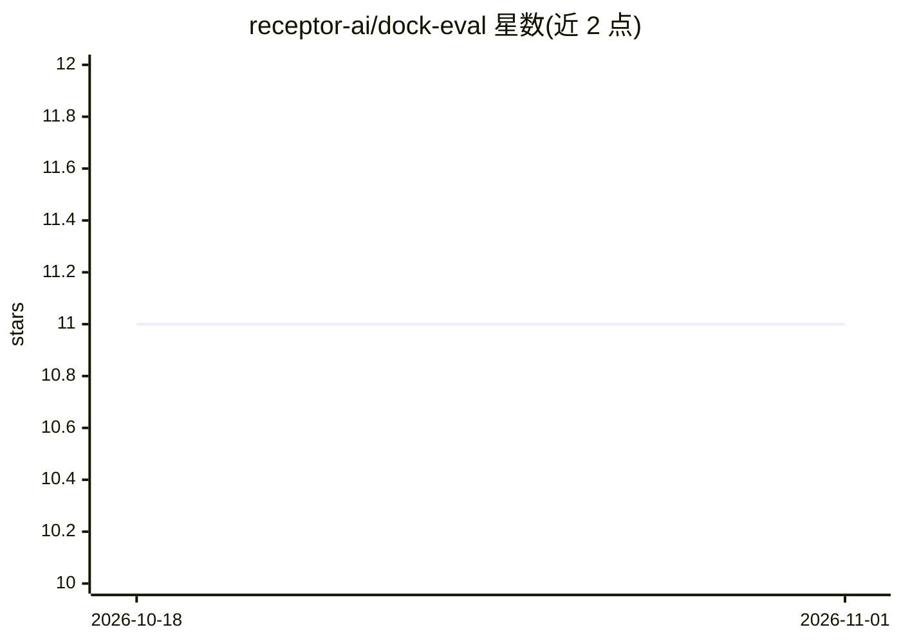

# receptor-ai/dock-eval

⭐ 11 · Python · 推送 2026-01-31 · [GitHub](https://github.com/receptor-ai/dock-eval) · [官网](https://doi.org/10.1021/acs.jcim.5c02777) · 组织维护

**蛋白质-配体对接基准的搭建与评测代码库（PLINDER/PoseBusters）**

ArtiDock 论文的配套代码：提供经典对接工具（AutoDock 系列与 Schrödinger Glide）的输入数据处理、对接运行脚本与结果评测流程，基准为 PLINDER 与 PoseBusters。数据集从 Zenodo 下载，环境用 conda 分别创建 autodock 与 dock-eval 两个环境；Glide 需用户自装 Schrödinger Suite，AutoDock-GPU 为可选安装并在 RTX 3000/4000 与 CUDA 12.4 上测试过。提供 Jupyter 示例与命令行入口，TODO 中列出虚拟筛选模式与单元测试。

## 筛选速览

| 维度 | 判定 | 备注 |
|---|---|---|
| AI 角色 | `ai-ecosystem` | LLM/agent 周边工具 |
| 许可风险 | `none` | — |
| 部署形态 | `library` | 以包/库形式分发 |
| 模型依赖 | — | README 未给出锁定关系 |
| 硬件要求 | — | 无带数字的原话,不猜 |
| 安装摩擦 | `medium` | 含编译或系统依赖之一 |
| 成熟度 | — | 结构信号不足 |

## 能力要点

- 覆盖 PLINDER 与 PoseBusters 两个蛋白-配体对接基准
- 支持 AutoDock-CPU/GPU 与 Glide 的对接运行与统一评测
- conda 环境隔离（autodock 与 dock-eval）
- 提供 docking/evaluate 的 Jupyter 示例与 CLI 入口

## 适用场景

- 在标准基准上复现对接方法的评测结果
- 将自己的对接工具接入统一评测流程
- 为虚拟筛选管线选择对接与评测方案做参考

## 场景标签

`模型评测` · 领域:评测与运维

## 证据(README 行号)

> L3: This repository contains source code for the classical docking setup, input data processing, result generation, and 
> L5: Details: ArtiDock: Accurate Machine Learning Approach to Protein–Ligand Docking Optimized for High-Throughput Virtua

## 星数曲线

2026-10-18 11 → 2026-11-01 11（+0）

---
*卡片 v1 · prompt 1.4 · 生成 2026-11-01 · 置信度 mid · 依据 README sha `a0d9779a9324` · [字段定义](../../DATASET.md)*
